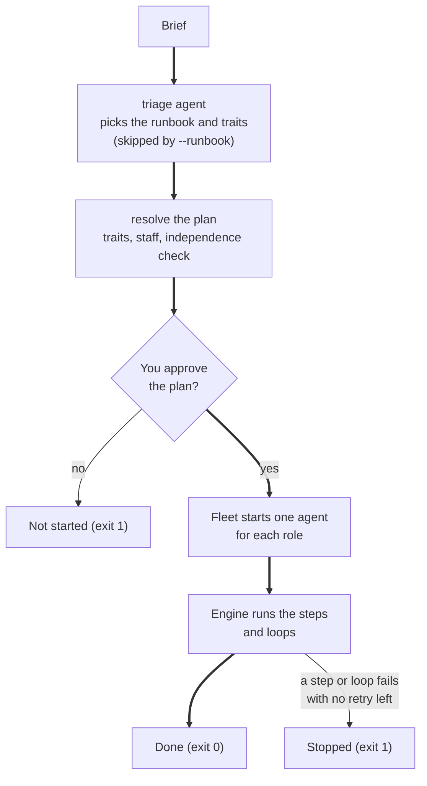
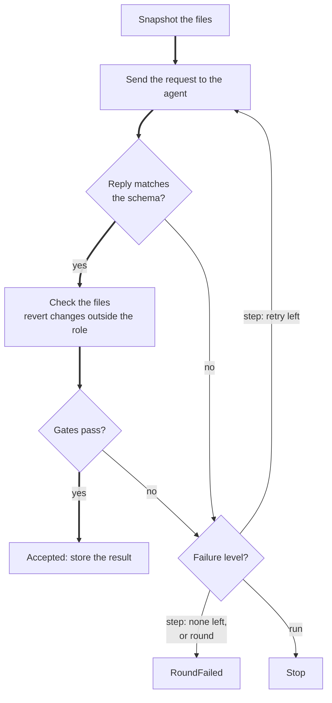

# Software factory

Describe what you want in your own words. The factory picks a plan, hands each step to an LLM agent, and checks every result itself before it moves on.

The factory can:

- build a web app (a React frontend, a FastAPI backend, or both),
- answer a research question in a report where every quote is checked against its source,
- audit existing code and write a prioritized report,
- design an HTTP API.

## Quick start

You need Python 3.11 or later, `uv`, and the `codex` and `claude` commands on your `PATH`. A frontend build also needs `npm`.

```bash
uv sync
uv run pytest                  # prints "141 passed"; no LLM is called
uv run factory runbooks        # lists api-design, code-audit, research and web-app
```

Set the environment variables that `llm.yaml` names before a real run:

| Variable | Used for |
|---|---|
| `ANTHROPIC_BASE_URL`, `ANTHROPIC_AUTH_TOKEN`, `ANTHROPIC_MODEL` | The `claude-agent-sdk` worker |
| `OPENAI_BASE_URL`, `OPENAI_API_KEY` | The `codex-gpt` worker |
| `GOOGLE_GEMINI_BASE_URL`, `GEMINI_API_KEY` | The `codex-gemini` worker. The verifier uses it by default. |
| `FACTORY_ROLES` | Optional. The path of another `roles.yaml`. |

Then start a run. It calls the LLMs and takes minutes.

```bash
uv run factory plan web-app --trait backend=yes     # show what a run would do; nothing runs
uv run factory run --brief "a shared shopping list for my family"
```

The factory shows its plan and waits for your OK. Add `--yes` to skip every question.

## What you can ask for

| Runbook | Use it to | Steps | You get |
|---|---|---|---|
| `web-app` | Build a frontend, a backend or both. Traits: `frontend` (default yes), `backend` (default no). | spec, API contract (full stack only), tests for each surface, then a build loop | `SPEC.json`, `API.json`, `web/`, `api/` |
| `research` | Answer a question from public sources. Trait: `review` (default yes). | plan, investigate each sub-question in parallel, then a write loop | `PLAN.json`, `REPORT.md` |
| `code-audit` | Review code without changing it. Needs `--target`. | audit through 4 lenses in parallel (security, correctness, maintainability, tests), then a write loop | `AUDIT.md` |
| `api-design` | Turn a brief into a spec and an HTTP API contract. | spec, then a contract loop | `SPEC.json`, `API.json` |

Examples:

```bash
uv run factory run --brief "a kanban board with tickets and columns"        # frontend only
uv run factory run --brief "a family shopping list" --trait backend=yes     # full stack
uv run factory run --brief "a URL shortener API" --runbook web-app \
    --trait frontend=no --trait backend=yes                                  # backend only
uv run factory run --brief "which vector database fits a 10M-document RAG system?"
uv run factory run --runbook code-audit --target apps/kanban-react --brief "is it ready to ship?"
uv run factory run --brief "..." --staff writer=codex-gpt --staff verifier=codex-gemini
```

Without `--runbook`, a triage agent reads the brief and chooses the runbook and its traits. The option `--trait` overrides its choice.

## What happens in a run



**Figure 1.** A run from brief to result. The thick line is a run that passes every check. The option `--yes` skips the approval.

1. The factory loads the settings, the runbooks and the staff.
2. It resolves the plan and refuses a plan that breaks the checker rule (see "Roles and staffing").
3. It asks you to approve the plan.
4. It creates and locks the folder `apps/<name>/`.
5. It starts one agent process for each role in the plan.
6. It runs the steps and loops in order.
7. It writes `run.json` and stops the agents.

At a **checkpoint** the factory shows you a result before it uses it. Press Enter to accept, or type the changes you want. The analyst can also ask you questions. Press Enter to let the agent decide. After 6 turns at one checkpoint, the run stops. A parallel step never pauses for a person.

### Where the results go

Each run works in `apps/<name>/`. Use `--name` to choose the name, or let the factory choose it from the brief. Runs with different names do not share files or ports.

| Path in `apps/<name>/` | Content |
|---|---|
| `SPEC.json`, `API.json`, `PLAN.json` | Results that a step saves |
| `REPORT.md`, `AUDIT.md` | Reports |
| `web/`, `api/` | The apps |
| `.factory/run.json` | Status, staff, one event for each attempt, and the LLM usage |
| `.factory/artifacts.json` | The result of every step |
| `.factory/agents/<role>.log` | The log of one agent |
| `.factory/lock` | Stops a second run with the same name |

The status in `run.json` is `running`, `accepted`, `stopped` or `error`. After an accepted run, the same name needs `--rebuild`.

### What a run costs

Every LLM call logs its worker, model, tokens and cost. `run.json` holds one row for each call, plus totals for the run and for each model. The console prints a `Usage:` line at the end. Claude reports a cost. Codex reports tokens only, so its cost shows as unknown.

The factory logs the cost. It does not limit it. `budgets.per_task_usd` caps one Claude call. No limit covers a whole run or a day.

## Commands and options

| Command or option | Effect |
|---|---|
| `factory runbooks` | Lists the runbooks and when to use each |
| `factory plan RUNBOOK` | Shows the plan without a run. Add `--mermaid` for a flowchart. |
| `factory run --brief TEXT` | Runs the factory. `--brief` is required. |
| `--runbook NAME` | Skips triage |
| `--trait NAME=yes\|no` | Sets a trait. Repeat it for more traits. |
| `--staff ROLE=WORKER[:MODEL]` | Sets who plays a role in this run |
| `--name NAME` | Works in `apps/NAME` |
| `--target PATH` | The code to audit |
| `--rebuild` | Redoes accepted work |
| `--yes` | Asks nothing. The agents decide and every checkpoint is accepted. |
| `--config`, `--agents`, `--runbooks` | Use other settings files |

## How the factory checks its agents

The engine never trusts a claim from an agent. It runs the tests itself and compares the counts. It reads the cited page and looks for the quote. A check that the engine runs on a result is a **gate**.

| Gate | What it checks | On failure |
|---|---|---|
| `tests_named` | Each criterion of the surface has a test named after it. No test is skipped, focused or marked todo. | retry the step |
| `tests_red` | The new tests load and at least one fails. | retry the step |
| `tests_green` | The suite loads and no test fails. | new round |
| `serves` | The build serves: `vite build` and preview, or uvicorn answering `/openapi.json`. | new round |
| `counts_match` | The verifier's counts equal the counts of the engine's own run. | retry the step |
| `criteria_covered` | Every criterion has a verdict that starts with `PASS`. | stop the run |
| `citations_verified` | Each finding quote is on the page that it cites. The gate drops the others. | retry the step |
| `sources_cited` | The report links every verified source and no other source. | retry the step |
| `evidence_verified` | Each audit finding has its evidence within 5 lines of the cited line. The gate drops the others. | retry the step |
| `review_approves` | The reviewer approved. Otherwise its issues go back to the author. | new round |

The gates `citations_verified` and `evidence_verified` fail only when no finding survives. A quote needs 20 characters or more. The gate ignores case, punctuation, spacing and citation markers such as `[1]`.



**Figure 2.** One attempt at a step. The thick line is an attempt that passes. A retry sends the failure message back as feedback.

- A step has `retries`. The default is 1, so a step has 2 attempts.
- A **loop** repeats its steps in rounds until they pass. `rounds: budget` means 1 + `budgets.max_retries`, which is 2 rounds with the shipped settings. The research `write` loop uses 3.
- A failed round gives its feedback to the first step of the next round. If that step runs for each surface, only the failed surfaces run again.
- If every round fails, the run stops with the last problem. Outside a loop, a failed step also stops the run.

Rules about files:

- A role with `writes: none` must not change files. The engine reverts such changes and goes on.
- A role with `writes: tests` or `writes: source` can change only the files that its template allows. The engine reverts anything else and fails the attempt.
- A developer can change a test only with a stated reason. The tester reviews the change. The engine reverts it if the tester does not approve.
- The first step that writes code resets each scaffold to its template. The reset keeps `node_modules` and `.venv`.

## Roles and staffing

A **role** is a job in a runbook. `roles.yaml` defines each role. `agents.yaml` says which worker plays it.

| Role | Does | Default worker | Tools |
|---|---|---|---|
| `triage` | Picks the runbook, the traits and a name | `claude-agent-sdk` | none |
| `analyst` | Turns a brief into a spec or a research plan. Asks you questions. | `claude-agent-sdk` | none |
| `architect` | Designs the API contract | `claude-agent-sdk` | none |
| `tester` | Writes the tests first. Judges a test change. | `codex-gpt` | edit, test |
| `developer` | Builds the code that passes the tests | `codex-gpt` | edit, test, build |
| `verifier` | Runs the tests and judges each criterion | `codex-gemini` | test |
| `researcher` | Answers one sub-question with quoted sources | `claude-agent-sdk` | web, search, curl |
| `auditor` | Reviews code through one lens | `claude-agent-sdk` | none |
| `writer` | Writes the report from verified material | `claude-agent-sdk` | none |
| `reviewer` | Approves a deliverable or sends it back | `codex-gpt` | none |

Every role can read files. The tools map to worker permissions. Claude gets `--allowedTools`. Codex gets the sandbox `read-only`, or `workspace-write` for a role that can edit or run a command. The commands `search` and `curl` also open network access.

**The checker rule.** A checker must use a different model than the author. The reviewer differs from the writer and from the architect. The verifier differs from the developer. The rule applies to a pair only when both roles are in the plan. The factory refuses a plan that breaks it. The setting `reviewer.must_differ_from_author` turns it on, and it is on by default.

To change who plays a role, edit `agents.yaml`, give a runbook its own `staff:` block, or use `--staff` for one run. A staff entry can also set `model:` and `url:`. With `url:`, the factory uses an agent that you already run at that A2A address and starts none.

## Settings

### llm.yaml

`llm.yaml` holds the endpoints, workers, allowed models and budgets. The text `${VAR}` takes its value from the environment. The loader rejects a literal key.

| Setting | Shipped value | Effect |
|---|---|---|
| `llm.allowed_models` | `${ANTHROPIC_MODEL}`, `gpt-6.1-sol`, `gemini-3.6-flash` | Every model must be in this list |
| `workers.<name>.enabled` | `true` for all 3 workers | A disabled worker needs no variables |
| `workers.<name>.harness` | `claude-agent-sdk` or `codex` | The command that runs the worker |
| `reviewer.must_differ_from_author` | `true` | Turns on the checker rule |
| `reviewer.candidates` | 3 models | Checked when the file loads. No run picks a reviewer from them. |
| `budgets.per_task_usd` | `30` | The cost cap of one Claude call |
| `budgets.per_day_usd` | not set | No code reads it |
| `budgets.max_retries` | `1` | A `budget` loop has 1 + this many rounds |

To switch a worker off, set `enabled: false`. A role that needs it must then use another worker.

### roles.yaml

Edit a prompt or a capability here, or add a block for a new role. No code changes. The loader checks the file. A bad file gives `error: ...` and exit code 2.

| Field | Default | Effect |
|---|---|---|
| `title` | required | The short name in plans and output |
| `description` | required | One sentence on the agent card |
| `prompt` | required | The standing instructions. `{search}` becomes the search command. |
| `edit` | `false` | The role can create and change files |
| `web` | `false` | The role can fetch web pages |
| `runs` | none | The commands the role can run: `test`, `build`, `search`, `curl` |
| `asks` | `false` | The role can pause to ask you questions |

## Add a kind of work

A runbook is a YAML file in `runbooks/`. To add a kind of work, add a file. The engine does not change. The factory validates a runbook when it loads: an unknown role, output, gate, trait, variable or step reference is an error with a reason.

| Step field | Default | Effect |
|---|---|---|
| `role` | required | The role that does the step |
| `instructions` | required | The task, with `{{ brief }}`, `{{ item.* }}`, `{{ surfaces }}`, `{{ test_files }}` and similar variables |
| `when` | always | A trait condition such as `frontend and backend` |
| `for_each` | none | `surfaces`, a list, or `<step>.<field>` |
| `parallel` | `false` | Runs the items together, at most 6 at a time |
| `reads` | none | The earlier results that the agent gets as context |
| `output` | none | The schema that the reply must match. A wrong reply goes back to the agent. |
| `gates` | none | The checks that the engine runs |
| `checkpoint` | `false` | You review the result |
| `save` | none | The file that receives the result |
| `retries` | `1` | The extra attempts after a failure |
| `cwd` | `surface` or `workspace` | The folder where the agent works. `target` is also allowed. |
| `writes` | `none` | `none`, `tests` or `source` |

A `loop` has `rounds` (default `budget`) and its own `gates`. `scaffolds` places a template in a surface folder when its trait condition holds.

Try a runbook before you run it: `uv run factory plan <runbook> --trait ...`.

### Templates

A template is a scaffold folder `templates/<name>/` with its metadata in `templates/<name>.yaml`. The metadata gives the stack notes, the test command and suite, how to serve it, and which files are tests, source or protected. The shipped templates are `react-vite` (React, Vitest, Testing Library) and `fastapi` (FastAPI, pytest, uv). In a full-stack app, the web dev server proxies `/api` to the backend.

### Web search

Researchers do not use native web search. They use the factory's own search, which queries public APIs:

```bash
uv run python -m factory.search "sqlite concurrent writes" --sources wikipedia,openalex,hackernews,github,stackoverflow,npm --limit 5
```

They then fetch the pages they cite. The `citations_verified` gate checks every quote against its page.

## Develop

The code is in `src/factory/`:

| File | Holds |
|---|---|
| `cli.py` | The commands and options |
| `runbook.py` | Runbook loading and validation, trait resolution, staffing, the plan outline |
| `engine.py` | Steps, loops, retries, role checks, checkpoints, the workspace lock, `run.json` |
| `gates.py` | The gates and the test and serve runners |
| `schemas.py` | The `SCHEMAS` table: the model, reply format and run rule of each deliverable |
| `roles.py`, `config.py` | `roles.yaml` and `llm.yaml` loading |
| `agent.py` | The generic role agent: prompt, worker call, reply check |
| `fleet.py` | Starts and stops the agent processes |
| `invoke.py` | Claude and Codex calls, per-role tools, and their usage |
| `a2a_transport.py` | The A2A server, client and agent cards |
| `scaffold.py`, `search.py`, `process.py`, `paths.py` | Templates, web search, command running, folder paths |

Run the tests with `uv run pytest`. The engine tests use fake agents, so no test calls an LLM or the network.

| Test file | Tests | What it proves |
|---|---|---|
| `test_a2a_transport.py` | 5 | A task returns its result, asks for input on the same task, fails with a reason, and serves its card. |
| `test_config.py` | 32 | `llm.yaml` loads, rejects literal keys and unknown models, and needs two reviewer candidates when the checker rule is on. |
| `test_engine.py` | 24 | Gates, retries, rounds, role checks, checkpoints, triage and the workspace lock work with fake agents. |
| `test_roles.py` | 17 | `roles.yaml` loads, rejects bad files with a reason, and can be replaced with `FACTORY_ROLES`. |
| `test_runbooks.py` | 29 | The shipped runbooks load, traits resolve, conditions are safe, and bad runbooks are refused. |
| `test_schemas.py` | 17 | Each deliverable schema accepts good data, rejects bad data and renders as text. |
| `test_usage.py` | 17 | Each LLM call reports its tokens and cost, and `run.json` sums them per step and per model. |

No person has run the factory live for this README. The live run calls the workers and the network. The tests do not.

Fixed constants: an agent card wait of 30 seconds (`START_TIMEOUT`), 900 seconds for a Codex call and 1500 seconds for a Claude call (`CODEX_TIMEOUT`, `CLAUDE_TIMEOUT`), 2 calls for a usable reply (`LLM_ATTEMPTS`), 300 seconds for a test or build command (`CMD_TIMEOUT`), 12 seconds for one search source, and a run name of 1 to 40 characters (lowercase letters, digits and hyphens).

## Troubleshooting

| Problem | Cause | Solution |
|---|---|---|
| `error: environment variables not set: ...` | A `${VAR}` in `llm.yaml` has no value. | Set the variables in "Quick start". |
| `error: no runbook 'x'; runbooks are ...` | The runbook name is wrong. | Run `factory runbooks`. |
| `... both use <model>; the reviewer must use a different model` | A checker and its author share a model. | Change `agents.yaml` or use `--staff`. |
| `apps/<name> already holds accepted work` | A run with this name finished. | Add `--rebuild`, or choose another `--name`. |
| `<name> is already being worked on by another run` | Another process holds the lock. | Wait for that run, or choose another `--name`. |
| `needs --target, an existing directory` | The `code-audit` runbook has no target. | Add `--target PATH`. |
| `error: ... roles.yaml ...` | The roles file is not valid. | Read the reason in the message and fix the file. |
| `factory.search: unrecognized arguments` | `--sources` got a space-separated list. | Write `--sources wikipedia,openalex`. |
| A search source returns HTTP 429 | The public API limits the rate. | Wait and try again. The other sources still answer. |
| Claude Code warns about an unknown model | The gateway model name is not in its list. | Ignore the warning. The call works. |
| Codex warns about missing metadata for `gemini-3.6-flash` | Codex does not know the model. | Ignore the warning. Codex uses fallback metadata. |

## Known limits

- **A run can end with a draft.** In `research`, the `report` step saves `REPORT.md` before `review` runs. If the reviewer does not approve in 3 rounds, the run stops with exit code 1. The draft stays on disk with a `> **NOT APPROVED.**` banner at its top. Read the banner before you use the file.
- **Port race.** `free_port()` closes its socket before the agent binds the port. Another process can take it. The fleet then gives up after 30 seconds.
- **The card check is weak.** The fleet compares only the tags `role:`, `worker:` and `model:`. A different agent with the same tags passes.
- **Agents keep state in memory.** A task is lost when its agent stops. A task cannot resume, and there is no `--resume`.
- **Same folder.** The task carries the path of the workspace. An agent at a `url:` must see the same folder.
- **Codex has no command list.** Any command makes the Codex sandbox writable. The engine reverts the writes of a role with `writes: none` after the attempt.
- **The reviewer candidates are not used in a run.** The reviewer model comes from `agents.yaml`. `reviewer.candidates` is only validated at load time. The checker rule is `_check_independence()` in `runbook.py`, which covers only the pairs in "Roles and staffing".
- **A test gap is not retried.** If the tests are green and a criterion is not `PASS`, the run stops.
- **Quotes under 20 characters fail.** `quote_on_page()` rejects them, and the gate drops that finding.
- **Search has no retry.** A rate limit removes that source from the result.
- **No read timeout on a task.** A hung agent blocks the run until its LLM call reaches its limit.

## Glossary

| Term | Meaning |
|---|---|
| A2A | The agent-to-agent protocol. An agent serves a card and accepts tasks. |
| Agent | A process that plays one role and calls one worker. |
| Agent card | The description that an agent serves. Its tags show the role, worker and model. |
| Artifact | The saved result of a step. |
| Brief | The request that you write in your own words. |
| Checkpoint | A pause where you review a result. |
| Contract | The list of API endpoints with example bodies. |
| Criterion | One testable statement in a spec. It has an id such as `AC1`. |
| Engine | The code that runs a plan: steps, loops, retries, checks and checkpoints. |
| Fleet | The set of agent processes of one run. |
| Gate | A check that the engine runs itself on a result. |
| Harness | The command that runs a worker: `claude` or `codex`. |
| Item | One unit of a step, such as one surface or one sub-question. |
| Loop | A group of steps that repeat in rounds until they pass. |
| Plan | A runbook with its traits, staff and scaffolds resolved. |
| Role | A job in a runbook, such as `developer`. |
| Round | One pass through the steps of a loop. |
| Runbook | A YAML file that describes one kind of work. |
| Scaffold | A template copied into a run, such as `web/` or `api/`. |
| Staff | The map from each role to a worker and a model. |
| Step | One task for one role, with an output and gates. |
| Surface | A part of a web app: `web` (frontend) or `api` (backend). |
| Template | A scaffold folder with its metadata in `templates/<name>.yaml`. |
| Trait | A yes-or-no choice that changes a runbook, such as `backend`. |
| Triage | The choice of a runbook and its traits for a brief. |
| Worker | An entry in `llm.yaml`: a harness, an endpoint and a list of models. |
| Workspace | The folder `apps/<name>/` of one run. |
