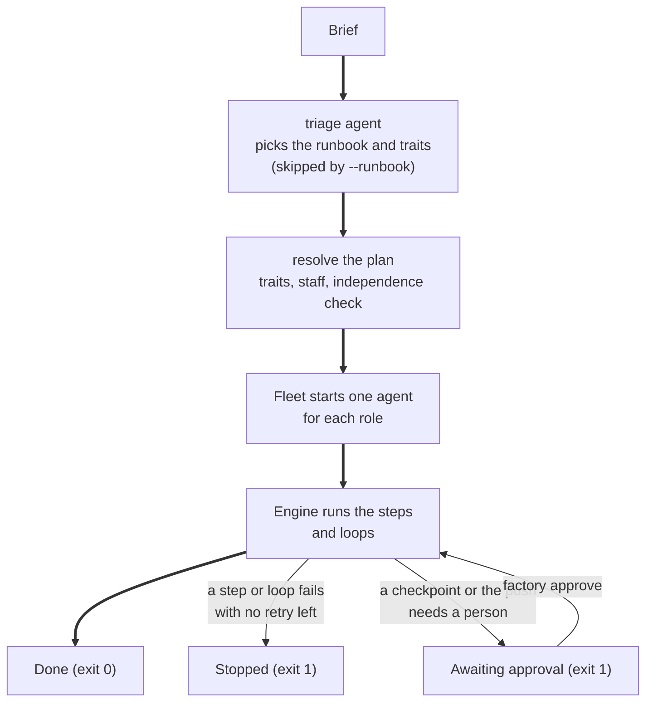
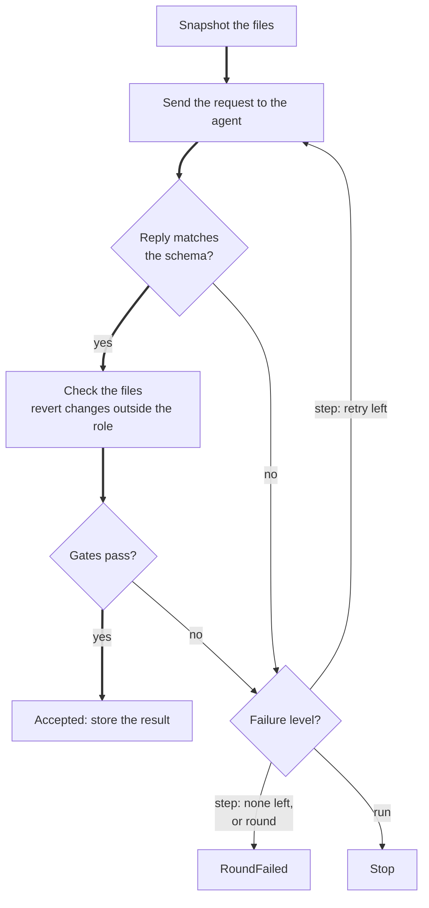

# Software factory

Describe what you want in your own words. The factory picks a plan, hands each step to an LLM agent, and checks every result itself before it moves on.

The factory can:

- build a web app (a React frontend, a FastAPI backend, or both),
- answer a research question in a report where every quote is checked against its source,
- audit existing code and write a prioritized report,
- design an HTTP API,
- change an existing git repo and commit the change on its own branch,
- fix a bug in an existing git repo, starting from a test that fails because of the bug,
- say which services a change would affect, from one or more repos, and change none of them.

## Quick start

You need Python 3.11 or later, `uv`, and the `codex` and `claude` commands on your `PATH`. A frontend build also needs `npm`.

```bash
uv sync
uv run pytest                  # prints "384 passed"; no LLM is called
uv run factory runbooks        # lists api-design, bug-fix, change-request, code-audit, impact-analysis, research and web-app
```

Set the environment variables that `llm.yaml` names before a real run:

| Variable | Used for |
|---|---|
| `ANTHROPIC_BASE_URL`, `ANTHROPIC_AUTH_TOKEN`, `ANTHROPIC_MODEL` | The `claude-agent-sdk` worker |
| `OPENAI_BASE_URL`, `OPENAI_API_KEY` | The `codex-gpt` worker |
| `GOOGLE_GEMINI_BASE_URL`, `GEMINI_API_KEY` | The `codex-gemini` worker. The verifier uses it by default. |
| `FACTORY_ROLES` | Optional. The path of another `roles.yaml`. |

Then start a run. It calls the LLMs and takes minutes.

```bash
uv run factory check                                    # one short prompt to each model: are they reachable?
uv run factory plan web-app --trait backend=yes     # show what a run would do; nothing runs
uv run factory run --brief "a shared shopping list for my family"
```

The factory shows its plan and starts. It never asks a question. When a run needs your review, it stops with the status `awaiting` and prints the command that answers it (`factory approve`). Add `--yes` to approve every review in advance.

## What you can ask for

| Runbook | Use it to | Steps | You get |
|---|---|---|---|
| `web-app` | Build a frontend, a backend or both. Traits: `frontend` (default yes), `backend` (default no). | spec, API contract (full stack only), tests for each surface, then a build loop | `SPEC.json`, `API.json`, `web/`, `api/` |
| `research` | Answer a question from public sources. Trait: `review` (default yes). | plan, investigate each sub-question in parallel, then a write loop | `PLAN.json`, `REPORT.md` |
| `code-audit` | Review code without changing it. Needs `--target`. | audit through 4 lenses in parallel (security, correctness, maintainability, tests), then a write loop | `AUDIT.md` |
| `api-design` | Turn a brief into a spec and an HTTP API contract. | spec, then a contract loop | `SPEC.json`, `API.json` |
| `bug-fix` | Fix a bug, an error, a crash or a regression in an existing git repo. Needs `--repo` and `--test-command`. | spec (the bug report; you approve it), a tester writes one test that fails because of the bug and the factory runs your tests to prove it fails, then a fix loop: a developer fixes the cause, the factory runs your tests, a reviewer reads the diff. One commit on a new branch. | `SPEC.json` and a commit on `factory/<name>` |
| `change-request` | Add a feature to, or deliberately change, code in an existing git repo. Not for bugs: use `bug-fix`. Needs `--repo` and `--test-command`. | spec (you approve it), then a build loop: a developer changes the code in a worktree, the factory runs your tests, a reviewer reads the diff. One commit on a new branch. | `SPEC.json` and a commit on `factory/<name>` |
| `impact-analysis` | Find which services a new feature or a change would affect, across one or more repos (for example the services of a microservice system). Needs one `--repo` for each repo. Changes nothing. | one auditor per repo reads it in place and lists its links to other services, each checked against the cited line; then a writer works out the impact and a reviewer checks it | `IMPACT.md` |

Examples:

```bash
uv run factory run --brief "a kanban board with tickets and columns"        # frontend only
uv run factory run --brief "a family shopping list" --trait backend=yes     # full stack
uv run factory run --brief "a URL shortener API" --runbook web-app \
    --trait frontend=no --trait backend=yes                                  # backend only
uv run factory run --brief "which vector database fits a 10M-document RAG system?"
uv run factory run --runbook code-audit --target apps/kanban-react --brief "is it ready to ship?"
uv run factory run --runbook change-request --repo ~/code/shop --test-command "npm test" \
    --brief "add a cart that shows the total" --name cart                    # a commit on factory/cart
uv run factory run --runbook bug-fix --repo ~/code/shop --test-command "npm test" \
    --brief "the cart total still counts an item after it is removed" --name total   # a commit on factory/total
uv run factory run --runbook impact-analysis --repo ~/code/orders --repo ~/code/payments \
    --brief "add a refund endpoint to payments" --name refund                # IMPACT.md, no repo changed
uv run factory run --brief "..." --staff writer=codex-gpt --staff verifier=codex-gemini
```

Without `--runbook`, a triage agent reads the brief and chooses the runbook and its traits. The option `--trait` overrides its choice. If no runbook fits the request, triage answers `none`. The factory then prints the reason, makes no folder and exits with code 1.

## What happens in a run



**Figure 1.** A run from brief to result. The thick line is a run that passes every check. The option `--yes` approves every review in advance, so the run never waits.

1. The factory loads the settings, the runbooks and the staff.
2. It resolves the plan and refuses a plan that breaks the checker rule (see "Roles and staffing").
3. It creates and locks the folder `apps/<name>/`.
4. It starts one agent process for each role in the plan.
5. It runs the steps and loops in order.
6. It writes `run.json` and stops the agents.

No command prompts. At a **checkpoint** a person must review a result before the run uses it. The run saves the draft, stops with the status `awaiting` and the detail `approval`, and prints the command that answers it. The run record has `awaiting: {point, approve}`.

```bash
uv run factory approve --name kanban                                   # accept the draft and continue the run
uv run factory approve --name kanban --changes "add a question on cost" # send the draft back with your words
```

`factory approve` writes your decision to `approvals` in `run.json`, then resumes the run. After `--changes`, the agent writes a new draft from your words and the run waits again. `--changes` applies to a checkpoint only. The push (see "Open a pull request") takes an approval only. An agent that runs the factory can pass `--yes` to approve every checkpoint and the push in advance. Each entry in `approvals` names who approved: `person` or `--yes`. The analyst does not ask questions during a run, because nobody is there to answer.

### Where the results go

Each run works in `apps/<name>/`. Use `--name` to choose the name, or let the factory choose it from the brief. Runs with different names do not share files or ports.

| Path in `apps/<name>/` | Content |
|---|---|
| `SPEC.json`, `API.json`, `PLAN.json` | Results that a step saves |
| `REPORT.md`, `AUDIT.md`, `IMPACT.md` | Reports |
| `web/`, `api/` | The apps |
| `.factory/run.json` | Status, staff, one event for each attempt, the LLM usage, and the fields in "The run record" below |
| `.factory/artifacts.json` | The result of every step |
| `.factory/tasks.json`, `.factory/TASKS.md` | The task list. See "The task list" below. |
| `.factory/agents/<role>.log` | The log of one agent |
| `.factory/lock` | Stops a second run with the same name |

The status in `run.json` is `running`, `awaiting`, `accepted`, `stopped` or `error`. After an accepted run, the same name needs `--rebuild`.

#### The run record

`run.json` identifies the run and the code that ran it:

| Field | Content |
|---|---|
| `run_id` | The ID that the console prints as `Run <id>`. Every request and agent log line carries it. |
| `factory` | `commit` and `dirty`: the git commit of the factory code and whether it had uncommitted changes. |
| `gates` | The names of the gates in the plan |
| `resumes` | One entry for each `--resume`, with its start time |
| `repo`, `base`, `branch`, `tree`, `commit` | Only for `change-request` and `bug-fix`. See "Change a git repo". |
| `pull_request` | Only after `--pr` opened one: `remote`, `branch`, `base`, `url`, `approved_by` and `approved_at`. |
| `approvals` | One entry for each decision on a checkpoint or the push: `point`, `decision` (`accept` or `changes`), `by` (`person` or `--yes`), `at` and, for `changes`, the `changes` text. |
| `awaiting` | Only while the status is `awaiting`: the `point` that waits and the `approve` command that answers it. |
| `test_command`, `pr` | The `--test-command` and `--pr` of the run, so `factory approve` and `--resume` can continue it. |
| `repos` | Only for `impact-analysis`: the folders it read. It has no branch and no commit. |

#### The task list

The task list shows how far a run got. A stopped run continues from it. The engine writes it when the run starts and keeps it current. `TASKS.md` is for a person. `tasks.json` is for `--resume`. The console prints the list at the start of a run, and `factory plan` prints the list a run starts with.

- An entry is one step, or one item of a step. Its status is `todo`, `running`, `accepted` or `failed`.
- A **sub-task** is one acceptance criterion of the spec. Only a step that reads the spec and writes code has sub-tasks, for example `change`, `fix`, `tests` and `develop`. An item for one surface gets the criteria of that surface.
- The agent names the criteria its work meets in `criteria_done` (in `dev_result` and `repro`). The engine marks them done after the files pass the write checks. An attempt whose files were reverted marks nothing.
- A step inside a loop is accepted for good only when the loop is accepted. When a round fails, the items it redoes go back to `todo`. The run record gets a `reopened` event for each.
- On `--resume`, an accepted item is not sent again. Any other item is sent with its open sub-tasks (`subtasks`) and the ids of its done ones (`subtasks_done`). A context block "Sub-tasks (this run was resumed)" tells the agent that the done work is already in the folder.
- A reset of the scaffolds throws the code away, so it reopens the sub-tasks.

```text
# Run task list

- [x] spec: analyst, accepted
- [!] change (build): developer, failed
  - [x] AC1: Adding an item shows it in the cart
  - [ ] AC2: The cart total is shown
- [ ] verify (build): reviewer, todo
```

A run that stops prints the command that continues it, for example after the LLM or the network went away:

```text
Stopped by an error: ConnectionError: connection reset
The work so far is kept. Continue it with: factory run --resume --name cart --repo /work/shop --test-command 'pytest -q'
```

### Change a git repo

The `change-request` runbook changes code in a repo that you already have. It never touches your checkout.

```bash
uv run factory run --runbook change-request --repo ~/code/shop --test-command "npm test" --brief "add a cart"
```

1. The factory makes a git **worktree** of the repo on a new branch `factory/<name>`. The branch starts at `--base` (default `HEAD`).
2. The analyst writes acceptance criteria. You approve them at the checkpoint.
3. The developer changes the code in the worktree. After each round the factory runs `--test-command` itself. The developer's word that the tests pass counts for nothing.
4. A reviewer reads the diff against the criteria. The reviewer must use a different model than the developer.
5. When the loop passes, the factory makes one commit. The message has the title of the spec, the criteria, and the run ID.

The folders live outside the repo, in `$FACTORY_SCRATCH` (default `~/factory-scratch`):

| Path | Content |
|---|---|
| `<scratch>/<repo>/<name>/tree/` | The worktree. The code is here. |
| `<scratch>/<repo>/<name>/.factory/` | `run.json`, `artifacts.json`, the agent logs and the lock |

The run ends with the branch, the worktree path, a `git diff <base>...factory/<name>` command to read the change, and a `git worktree remove <tree>` command to clean up. The factory does not merge or remove the worktree, and it pushes only with `--pr` (see "Open a pull request"). Two features of one repo can run at the same time. The same feature name twice cannot.

Rules:

- `--repo` and `--test-command` are required. `--test-command` is split into words and runs without a shell. `--repo`, `--base` and `--test-command` are refused for other runbooks. `--target` is refused with `--repo`.
- A branch `factory/<name>` that already exists is an error. Choose another `--name`.
- The factory warns when the repo has uncommitted changes. They are not in the worktree.
- A scratch folder inside the repo is refused.
- The engine reverts any change to `.git` and any write outside the worktree. A write outside the worktree fails the attempt.
- A run that ends with no file change stops. The factory does not commit an empty change.

### Open a pull request

`--pr` is for `change-request` and `bug-fix`. A push leaves your machine, so it needs an explicit request and an approval.

```bash
uv run factory run --runbook change-request --repo ~/code/shop --test-command "npm test" \
  --brief "add a cart" --pr
```

1. The run commits as before. Before the commit, the factory scans the changed files for secrets. A secret stops the run and nothing is committed.
2. Without `--yes`, the run stops with the status `awaiting` and the detail `approval`. Nothing is pushed. The console prints `factory approve --name <name>`. That command records you as the approver, then pushes and opens the pull request.
3. After an approval or with `--yes`, the factory runs `git push -u origin factory/<name>`, then `gh pr create`. The base is the branch that your checkout is on. A checkout on no branch is an error.
4. The pull request body holds the acceptance criteria, the gates that checked each step, the usage totals, the run ID and who approved. The record keeps the same in `pull_request`. `approved_by` is `person` or `--yes`.

If the push or `gh` fails, the commit stays on the branch. The run stops and prints the `--resume` command. The resume does not run an agent or commit again. A repo with no `origin` stops the run in the same way.

### Fix a bug

The `bug-fix` runbook fixes a bug in a repo that you already have. It works like `change-request`: a worktree on `factory/<name>`, your checkout untouched, one commit at the end, nothing pushed unless you pass `--pr`. It differs in that the fix starts from a failing test.

```bash
uv run factory run --runbook bug-fix --repo ~/code/shop --test-command "npm test" \
    --brief "the cart total still counts an item after it is removed" --name total
```

1. The analyst writes the bug report as a spec: the steps to reproduce, the expected and the actual behaviour, and the suspected cause. AC1 is "the bug no longer occurs". You approve the spec at the checkpoint.
2. A tester writes **one** test that fails because of the bug, and reports its name. The tester changes no source file.
3. The factory runs `--test-command` itself (gate `repro_fails`). The test command must fail, and its output must name the tester's test. If every test passes, the bug is not reproduced. If the suite fails without naming that test, it fails for another reason. Either way the tester tries again, and the run stops if the second try fails too.
4. The developer fixes the cause with the smallest change. The developer must not weaken, skip or delete the reproduction test. After each round the factory runs `--test-command` again, and every test must pass.
5. A reviewer reads the diff. The reviewer approves only if the reproduction test is still there, the change fixes the cause and not the symptom, and it touches only what the bug needs.
6. The factory makes one commit. It holds the reproduction test and the fix.

The folders, the flags and the rules are those of "Change a git repo". Both runbooks need `--repo` and `--test-command`.

### Impact across repos

The `impact-analysis` runbook answers a question such as "which services does this feature touch?". Give it one `--repo` for each repo, for example each service of a microservice system.

```bash
uv run factory run --runbook impact-analysis --repo ~/code/orders --repo ~/code/payments \
    --brief "add a refund endpoint to payments" --name refund
```

1. Each repo gets its own auditor. The auditor reads the repo **in place**, in parallel with the others.
2. The auditor lists the links between its service and the others. A link has one of seven kinds: `calls`, `publishes`, `subscribes`, `reads`, `writes`, `deploys_with` or `owns_contract`. It cites the file, the line and the exact code. The sources are the code, the API specs (OpenAPI, AsyncAPI, protobuf, GraphQL) and the deploy config (docker-compose, Kubernetes, Helm).
3. The gate `link_verified` checks each link against the cited file, as `evidence_verified` does for audit findings. A link that does not check is dropped. A repo with no links is a valid result.
4. A writer reads the verified links from every repo and writes `IMPACT.md`: the services the change affects directly, the services it affects through them, and the gaps.
5. A reviewer checks that each affected service is backed by a link.

Rules:

- Each folder name is a service name. Two `--repo` folders cannot have the same name.
- `--repo` must be the top folder of a git repo that has a commit. A folder inside a repo is refused.
- No repo is changed. The run never makes a worktree, a branch or a commit. If an agent changes a file or makes a commit in a repo, the engine puts it back and records a `files reverted` event.
- The run lives in `apps/<name>/`, like `code-audit`. `--resume` finds it there.
- `--base`, `--test-command` and `--target` are refused.

### What a run costs

Every LLM call logs its worker, model, tokens and cost. `run.json` holds one row for each call, plus totals for the run and for each model. The console prints a `Usage:` line at the end. Claude reports its cost. Codex reports tokens only, so the factory prices its calls from `docs/model-prices.md` (FR-30). A model with no price there shows its cost as unknown. The file is refreshed weekly with the skill `update-model-prices` or `uv run python -m factory.prices`. An alias such as `gpt-advantage-assist` takes the price of its target model.

The factory logs the cost. It does not limit it by default. A cap is optional: set `budgets.per_task_usd` to cap each Claude call, or leave it unset for no cap. Nothing limits a whole run or a day.

## Commands and options

| Command or option | Effect |
|---|---|
| `factory` | With no command: prints the runs in `apps/` and the runbooks. |
| `factory setup [--dir PATH]` | Installs a Claude Code session hook (`.claude/settings.json`) and an Agent Skill (`.claude/skills/factory/SKILL.md`) in `PATH` (default: here). Run it again and nothing changes. See "Ambient context". |
| `factory session` | Prints the name, status and cost of each run in `apps/`. The hook runs it at the start of a session. |
| `factory runbooks [--fields description,use_when,needs] [--full]` | Lists the runbooks: the total, then name, title and traits. `--fields` adds fields. |
| `factory plan RUNBOOK` | Shows the plan without a run. Add `--mermaid` for a flowchart. |
| `factory check [--worker NAME] [--fields seconds,tokens,cost_usd]` | Sends one short prompt to each enabled worker and model, in parallel, and prints ok or FAIL for each with the reply or error. It spends a few tokens per model and prints the cost, with Codex calls priced from the table. Exit code 0 only when every model answers. Run it before a long job. |
| `factory runs [--json]` | Sums the runs in `apps/`, totals first: runs by status, how often a step was accepted on its first attempt, rounds per loop, and the cost of each model. It only reads `run.json` files. |
| `factory run --brief TEXT` | Runs the factory. `--brief` is required. |
| `factory approve --name NAME [--changes TEXT]` | Answers a run with the status `awaiting`. Records you as the approver, then resumes the run. `--changes` sends a checkpoint's draft back. |
| `--runbook NAME` | Skips triage |
| `--trait NAME=yes\|no` | Sets a trait. Repeat it for more traits. |
| `--staff ROLE=WORKER[:MODEL]` | Sets who plays a role in this run |
| `--name NAME` | Works in `apps/NAME` |
| `--target PATH` | The code to audit |
| `--repo PATH` | Repeatable. For `change-request` or `bug-fix`, the one git repo that changes; the work happens in a worktree. For `impact-analysis`, each repo that is read in place. |
| `--base REF` | The commit that the new branch starts from. Default `HEAD`. |
| `--test-command CMD` | The command that runs the repo's tests, such as `"npm test"`. Required for `change-request` and `bug-fix`. |
| `--pr` | `change-request` and `bug-fix` only. After the commit, pushes the branch to `origin` and opens a pull request. Needs an approval: `factory approve` after the run waits, or `--yes` in advance. See "Open a pull request". |
| `--rebuild` | Redoes accepted work |
| `--resume` | Continues the stopped run in `--name`. It keeps the items that were accepted. It sends the other items with their open sub-tasks only (see "The task list"). It refuses a run that is accepted. |
| `--yes` | Approves in advance. Every checkpoint is accepted and, with `--pr`, the push is approved. The record names `--yes` as the approver. |
| `--config`, `--agents`, `--runbooks` | Use other settings files |

**Output.** `runbooks`, `runs` and `check` print TOON (Token-Optimized Object Notation) by default. TOON is YAML-like text that names the keys of a list once:

```text
total: 7
runbooks[7]{name,title,traits}:
  api-design,API design,none
  web-app,Build a web app,frontend backend
```

- `--json` prints JSON instead.
- A list shows 3 or 4 fields for each row. `--fields A,B` adds more. An unknown field is a bad command.
- Text over 200 characters is cut. The cut ends with the total size and `use --full`. `--full` shows all of it.
- Totals come first. An empty result says so, for example `runs: 0 found`.
- An error is data on stdout, for example `error: "no run to approve: ..."`, or `{"error": "..."}` with `--json`. Stderr carries logs only.
- `factory` with no command prints live data and not help text: the path of the program, a description, the runs in `apps/` and the runbooks.
- Each command ends with `help[]` lines. Each line is a command for a likely next step. A fixed flag stays and a run value is a placeholder such as `<run>`. For example, `factory runs` points to `factory approve --name <run>` when a run waits.
- `factory <command> --help` shows the flags and one example.

**Ambient context.** Run `factory setup --dir <folder>` once. The next Claude Code session in that folder starts with the output of `factory session`: the name, status and cost of each run, and the `factory approve` command for a run that waits. The Agent Skill tells the agent how to use the factory. `setup` adds one `SessionStart` hook and keeps the other settings. It refuses a `settings.json` that is not valid JSON and leaves it as it is.
- `factory run` and `factory plan` print text for a person, with `help[]` lines at the end. The files that a run saves are prose by design.

**Exit codes.** 0: the command succeeded. 1: the command failed, the run stopped or waits for approval, or the command was well formed but cannot be done (for example a bad config file or a missing run). 2: the command line is wrong (an unknown flag, a missing `--name`, a flag that does not fit the runbook).

## How the factory checks its agents

The engine never trusts a claim from an agent. It runs the tests itself and compares the counts. It reads the cited page and looks for the quote. A check that the engine runs on a result is a **gate**.

| Gate | What it checks | On failure |
|---|---|---|
| `tests_named` | Each criterion of the surface has a test named after it. No test is skipped, focused or marked todo. | retry the step |
| `tests_red` | The new tests load and at least one fails. | retry the step |
| `tests_green` | The suite loads and no test fails. | new round |
| `serves` | The build serves: `vite build` and preview, or uvicorn answering `/openapi.json`. | new round |
| `counts_match` | The verifier's counts equal the counts of the engine's own run. | retry the step |
| `criteria_covered` | Every criterion has a verdict that starts with `PASS`. | stop the run |
| `citations_verified` | Each finding quote is on the page that it cites. The gate drops the others. | retry the step |
| `sources_cited` | The report links every verified source and no other source. | retry the step |
| `evidence_verified` | Each audit finding has its evidence within 5 lines of the cited line. The gate drops the others. | retry the step |
| `link_verified` | Each service link has its evidence within 5 lines of the cited line, in a file of that repo. The gate drops the others. A repo with no links passes (`impact-analysis`). | retry the step |
| `review_approves` | The reviewer approved. Otherwise its issues go back to the author. | new round |
| `secrets_clean` | No file the agent wrote holds what looks like a secret: a key, a token, a private key or a real value in an env file. The message masks each value. | retry the step |
| `lint_clean` | The template's `lint` command exits 0 in each surface. A template with no `lint` command passes. | retry the step |
| `packages_exist` | Each npm and PyPI package in the manifests exists on its registry. A registry that cannot be reached does not fail the gate. The gate logs the names it could not check. | retry the step |
| `repo_tests_pass` | The `--test-command` exits 0 in the worktree. | new round |
| `repro_fails` | The `--test-command` fails in the worktree, and its output names the test that the tester reported (`bug-fix`). | retry the step |

The gates `citations_verified` and `evidence_verified` fail only when no finding survives. A quote needs 20 characters or more. The gate ignores case, punctuation, spacing and citation markers such as `[1]`.



**Figure 2.** One attempt at a step. The thick line is an attempt that passes. A retry sends the failure message back as feedback.

- A step has `retries`. The default is 1, so a step has 2 attempts.
- A **loop** repeats its steps in rounds until they pass. `rounds: budget` means 1 + `budgets.max_retries`, which is 2 rounds with the shipped settings. The research `write` loop uses 3.
- A failed round gives its feedback to the first step of the next round. If that step runs for each surface, only the failed surfaces run again.
- If every round fails, the run stops with the last problem. Outside a loop, a failed step also stops the run.

Rules about files:

- A role with `writes: none` must not change files. The engine reverts such changes and goes on.
- A role with `writes: tests` or `writes: source` can change only the files that its template allows. The engine reverts anything else and fails the attempt.
- A developer can change a test only with a stated reason. The tester reviews the change. The engine reverts it if the tester does not approve.
- The first step that writes code resets each scaffold to its template. The reset keeps `node_modules` and `.venv`.

## Roles and staffing

A **role** is a job in a runbook. `roles.yaml` defines each role. `agents.yaml` says which worker plays it.

| Role | Does | Default worker | Tools |
|---|---|---|---|
| `triage` | Picks the runbook, the traits and a name | `claude-agent-sdk` | none |
| `analyst` | Turns a brief into a spec or a research plan. Its draft is a checkpoint that a person reviews. | `claude-agent-sdk` | none |
| `architect` | Designs the API contract | `claude-agent-sdk` | none |
| `tester` | Writes the tests first. Judges a test change. | `codex-gpt` | edit, test |
| `developer` | Builds the code that passes the tests | `codex-gpt` | edit, test, build |
| `verifier` | Runs the tests and judges each criterion | `codex-gemini` | test |
| `researcher` | Answers one sub-question with quoted sources | `claude-agent-sdk` | web, search, curl |
| `auditor` | Reviews code through one lens | `claude-agent-sdk` | none |
| `writer` | Writes the report from verified material | `claude-agent-sdk` | none |
| `reviewer` | Approves a deliverable or sends it back | `codex-gemini` | none |

Every role can read files. The tools map to worker permissions. Claude gets `--allowedTools`. Codex gets the sandbox `read-only`, or `workspace-write` for a role that can edit or run a command. The commands `search` and `curl` also open network access.

**The checker rule.** A checker must use a different model than the author. The reviewer differs from the writer, the architect and the developer. The verifier differs from the developer. The rule applies to a pair only when both roles are in the plan. The factory refuses a plan that breaks it while a second model is enabled. When the enabled workers serve only one model, for example Claude alone, the rule cannot be met. The plan then runs, and `factory plan` and `factory run` print a warning. The best practice is a different model for every checker: enable a second worker in `llm.yaml` and give it to the reviewer and the verifier in `agents.yaml`. The setting `reviewer.must_differ_from_author` turns it on, and it is on by default.

To change who plays a role, edit `agents.yaml`, give a runbook its own `staff:` block, or use `--staff` for one run. A staff entry can also set `model:` and `url:`. With `url:`, the factory uses an agent that you already run at that A2A address and starts none.

**Fallback.** A role in `agents.yaml` can name a second worker for the last attempt of a step:

```yaml
roles:
  researcher: {worker: claude-agent-sdk, fallback: {worker: codex-gpt, model: gpt-6.1-sol}}
```

The earlier attempts use the main worker. Only the last attempt goes to the fallback. A fallback with the same worker and model as the main one fails to load. The checker rule applies to the fallback too, so a switch cannot break it.

## Settings

### llm.yaml

`llm.yaml` holds the endpoints, workers, allowed models and budgets. The text `${VAR}` takes its value from the environment. The loader rejects a literal key.

| Setting | Shipped value | Effect |
|---|---|---|
| `llm.allowed_models` | `${ANTHROPIC_MODEL}`, `gpt-6.1-sol`, `gpt-6-luna`, `gpt-advantage-assist`, `gemini-3.7-flash` | Every model must be in this list |
| `workers.<name>.enabled` | `true` for all 3 workers | A disabled worker needs no variables |
| `workers.<name>.plugin` | `factory.workers.claude` or `factory.workers.codex` | The module path of the plugin that runs the worker. Each plugin checks its own `options`. |
| `reviewer.must_differ_from_author` | `true` | Turns on the checker rule |
| `reviewer.candidates` | 3 models | Checked when the file loads. No run picks a reviewer from them. |
| `budgets.per_task_usd` | not set | Optional, not required. Caps the cost of one Claude call when set. Not set means no cap. |
| `budgets.per_day_usd` | not set | No code reads it |
| `budgets.max_retries` | `1` | A `budget` loop has 1 + this many rounds |

To switch a worker off, set `enabled: false`. A role that needs it must then use another worker.

#### Worker plugins

A worker runs through a **plugin**: a Python module named by `plugin:`. The factory imports every plugin when `llm.yaml` loads. A bad plugin stops the start with a reason. The old key `harness:` is refused with a message that names `plugin:`.

A plugin module defines a class `Plugin` with:

| Member | Does |
|---|---|
| `name` | A short name that messages use |
| `__init__(cfg, worker)` | Binds the plugin to one worker of the config |
| `validate(cfg, worker)` (class method) | Raises `ConfigError` if the worker's config does not suit the plugin |
| `run(prompt, cwd, tools, model)` | Runs the worker once. Returns the text and the usage. On a failure, raises `LLMFailed` with the usage already spent. |

Every call must report its worker, model, tokens and cost. A worker can set `options:` for its plugin. A plugin that takes none rejects them. The file `src/factory/workers/base.py` holds the full interface.

### roles.yaml

Edit a prompt or a capability here, or add a block for a new role. No code changes. The loader checks the file. A bad file gives `error: ...` and exit code 1.

| Field | Default | Effect |
|---|---|---|
| `title` | required | The short name in plans and output |
| `description` | required | One sentence on the agent card |
| `prompt` | required | The standing instructions. `{search}` becomes the search command. |
| `edit` | `false` | The role can create and change files |
| `web` | `false` | The role can fetch web pages |
| `runs` | none | The commands the role can run: `test`, `build`, `search`, `curl` |
| `asks` | `false` | The role may ask questions. Commands never prompt, so a run sends no question to a person. The role states its assumptions instead. |

## Add a kind of work

A runbook is a YAML file in `runbooks/`. To add a kind of work, add a file. The engine does not change. The factory validates a runbook when it loads: an unknown role, output, gate, trait, variable or step reference is an error with a reason.

| Step field | Default | Effect |
|---|---|---|
| `role` | required | The role that does the step |
| `instructions` | required | The task, with `{{ brief }}`, `{{ item.* }}`, `{{ surfaces }}`, `{{ test_files }}` and similar variables |
| `when` | always | A trait condition such as `frontend and backend` |
| `for_each` | none | `surfaces`, a list, or `<step>.<field>` |
| `parallel` | `false` | Runs the items together, at most 6 at a time |
| `reads` | none | The earlier results that the agent gets as context |
| `output` | none | The schema that the reply must match. A wrong reply goes back to the agent. |
| `gates` | none | The checks that the engine runs |
| `checkpoint` | `false` | You review the result |
| `save` | none | The file that receives the result |
| `retries` | `1` | The extra attempts after a failure |
| `cwd` | `surface` or `workspace` | The folder where the agent works. `target` is also allowed. |
| `writes` | `none` | `none`, `tests` or `source` |

A `loop` has `rounds` (default `budget`) and its own `gates`. `scaffolds` places a template in a surface folder when its trait condition holds.

Try a runbook before you run it: `uv run factory plan <runbook> --trait ...`. Check the models first with `uv run factory check`.

### Templates

A template is a scaffold folder `templates/<name>/` with its metadata in `templates/<name>.yaml`. The metadata gives the stack notes, the test command and suite, how to serve it, and which files are tests, source or protected. The shipped templates are `react-vite` (React, Vitest, Testing Library) and `fastapi` (FastAPI, pytest, uv). In a full-stack app, the web dev server proxies `/api` to the backend.

### Web search

Researchers do not use native web search. They use the factory's own search, which queries public APIs:

```bash
uv run python -m factory.search "sqlite concurrent writes" --sources wikipedia,openalex,hackernews,github,stackoverflow,npm --limit 5
```

They then fetch the pages they cite. The `citations_verified` gate checks every quote against its page.

## Develop

The code is in `src/factory/`:

| File | Holds |
|---|---|
| `cli.py` | The commands and options |
| `runbook.py` | Runbook loading and validation, trait resolution, staffing, the plan outline |
| `engine.py` | Steps, loops, retries, role checks, checkpoints, the workspace lock, `run.json` |
| `tasks.py` | The task list: `tasks.json`, `TASKS.md` and the sub-tasks |
| `gates.py` | The gates and the test and serve runners |
| `schemas.py` | The `SCHEMAS` table: the model, reply format and run rule of each deliverable |
| `roles.py`, `config.py` | `roles.yaml` and `llm.yaml` loading |
| `agent.py` | The generic role agent: prompt, worker call, reply check |
| `fleet.py` | Starts and stops the agent processes |
| `invoke.py` | The one entry for an LLM call. It runs the worker's plugin and prices a call whose worker reports no cost. |
| `prices.py`, `docs/model-prices.md` | The price table and its weekly refresh from llm-prices.com (FR-30) |
| `workers/` | The plugin interface (`base.py`), the loader, and the `claude` and `codex` plugins |
| `repo.py` | Worktrees, the write guard and the commit for `change-request` and `bug-fix` |
| `check.py` | `factory check` |
| `runs.py` | `factory runs` |
| `out.py` | TOON, `--json`, `--fields`, `--full` and errors as data |
| `a2a_transport.py` | The A2A server, client and agent cards |
| `scaffold.py`, `search.py`, `process.py`, `paths.py` | Templates, web search, command running, folder paths |

Run the tests with `uv run pytest`. The engine tests use fake agents, so no test calls an LLM or the network.

| Test file | Tests | What it proves |
|---|---|---|
| `test_a2a_transport.py` | 5 | A task returns its result, asks for input on the same task, fails with a reason, and serves its card. |
| `test_check.py` | 6 | `factory check` tries every enabled model, reports usage and failures with the totals first, and sets the exit code. |
| `test_out.py` | 31 | TOON encodes lists, objects and strings that need quotes; `--json`, `--fields` and `--full` work; totals come first; an empty result says so; errors are data on stdout; `factory` alone prints live data; `help[]` lines end a command; each `--help` has one example; `factory setup` installs the session hook and the Agent Skill once; `factory session` prints the runs. |
| `test_config.py` | 33 | `llm.yaml` loads, rejects literal keys and unknown models, makes `per_task_usd` optional, and loads a config with one model. |
| `test_approve.py` | 9 | A checkpoint and the push wait at `awaiting: approval`, `factory approve` answers them with a person's decision or `--changes`, `--yes` is recorded as such, and a bad command exits 2. |
| `test_engine.py` | 24 | Gates, retries, rounds, role checks, checkpoints, triage and the workspace lock work with fake agents. |
| `test_fallback.py` | 5 | A role's fallback takes the last attempt only, and a bad fallback fails to load. |
| `test_bugfix.py` | 12 | `bug-fix` proves the bug with a failing test before the fix, makes one commit, and leaves the checkout unchanged. |
| `test_pr.py` | 18 | `--pr` pushes only with `--yes`, waits at `awaiting: approval` without it, scans for secrets before the commit, puts the criteria, gates and usage in the pull request, and a resume after a failed push does not commit again. |
| `test_impact.py` | 23 | `impact-analysis` keeps only the links whose evidence is in the cited file, reads each repo in place, reverts any change to a repo, and refuses bad `--repo` values. |
| `test_gates_p6.py` | 35 | `secrets_clean`, `lint_clean` and `packages_exist` catch what they must, mask secrets and survive a registry outage. |
| `test_repo.py` | 24 | Worktrees, the write guard, the test gate and the commit work on real git repos, and the original checkout stays unchanged. |
| `test_tasks.py` | 13 | The task list is written at the start, a stop mid-item keeps the done sub-tasks, a resume sends only the open ones, a reverted attempt marks none, and every stop prints the `--resume` command. |
| `test_resume.py` | 5 | A resumed run keeps its accepted items, and `--resume` refuses a missing or accepted run. |
| `test_roles.py` | 17 | `roles.yaml` loads, rejects bad files with a reason, and can be replaced with `FACTORY_ROLES`. |
| `test_runbooks.py` | 37 | The shipped runbooks load, traits resolve, conditions are safe, and bad runbooks are refused. The reviewer must not share the developer's model. With only Claude enabled, every runbook plans and warns. |
| `test_runs.py` | 5 | `factory runs` sums the run records and changes nothing. |
| `test_schemas.py` | 19 | Each deliverable schema accepts good data, rejects bad data and renders as text. Triage can answer `none`. |
| `test_tracing.py` | 9 | The run ID, the factory commit and the gate names reach `run.json` and every request. |
| `test_usage.py` | 17 | Each LLM call reports its tokens and cost, and `run.json` sums them per step and per model. |
| `test_prices.py` | 15 | The price table prices each Codex model and alias, refreshes from the feed without changing the file on a failure, and fills a missing Codex cost. |
| `test_workers.py` | 22 | The plugin loader accepts a good plugin, rejects bad ones, and the shipped plugins build their commands. |

No person has run the factory live for this README. The live run calls the workers and the network. The tests do not.

Fixed constants: an agent card wait of 30 seconds (`START_TIMEOUT`), 900 seconds for a Codex call and 1500 seconds for a Claude call (`CODEX_TIMEOUT`, `CLAUDE_TIMEOUT`), 2 calls for a usable reply (`LLM_ATTEMPTS`), 300 seconds for a test or build command (`CMD_TIMEOUT`), 12 seconds for one search source, and a run name of 1 to 40 characters (lowercase letters, digits and hyphens).

## Troubleshooting

| Problem | Cause | Solution |
|---|---|---|
| `error: environment variables not set: ...` | A `${VAR}` in `llm.yaml` has no value. | Set the variables in "Quick start". |
| `error: "no runbook 'x'; runbooks are ..."` | The runbook name is wrong. | Run `factory runbooks`. |
| `FAIL ... model 'x' is not in llm.allowed_models` or a load error at start | A model in `llm.yaml` is not in `llm.allowed_models`. | Add it to `allowed_models`, or remove it from the worker. Run `factory check` to confirm. |
| `... both use <model>; the reviewer must use a different model` | A checker and its author share a model. | Change `agents.yaml` or use `--staff`. |
| `apps/<name> already holds accepted work` | A run with this name finished. | Add `--rebuild`, or choose another `--name`. |
| `<name> is already being worked on by another run` | Another process holds the lock. | Wait for that run, or choose another `--name`. |
| `needs --target, an existing directory` | The `code-audit` runbook has no target. | Add `--target PATH`. |
| `runbook change-request needs --test-command` or `--repo` (also `bug-fix`) | The runbook changes a git repo and runs your tests. | Add `--repo PATH` and `--test-command "..."`. |
| `runbook impact-analysis reads git repos: pass --repo PATH once for each repo` | No repo was given. | Add one `--repo PATH` for each repo to read. |
| `two --repo folders have the name orders` | Two repos share a folder name, and the folder name is the service name. | Rename one folder, or give the repo a folder with another name. |
| `the bug is not reproduced: every test passes` | The tester's test passes, or the tester wrote no test. | Describe the steps to reproduce in the `--brief`, or check that `--test-command` runs the new test. |
| `the failing output does not name your test` | The suite fails for another reason, or the command hides test names. | Fix the failing suite first, or use a test command that prints the name of each failing test. |
| `branch factory/<name> already exists` | An earlier run used the name. | Choose another `--name`, or delete the branch. |
| `--resume needs --name` or `no run to resume` | `--resume` has no run to continue. | Give the `--name` of a stopped run. |
| `no run to approve` or `not awaiting approval` | `factory approve` has no run, or the run does not wait. | Give the `--name` of a run with the status `awaiting`. |
| `There is no runbook for this request` | Triage answered `none`. | Rephrase the brief, or add a runbook. |
| `error: ... roles.yaml ...` | The roles file is not valid. | Read the reason in the message and fix the file. |
| `factory.search: unrecognized arguments` | `--sources` got a space-separated list. | Write `--sources wikipedia,openalex`. |
| A search source returns HTTP 429 | The public API limits the rate. | Wait and try again. The other sources still answer. |
| Claude Code warns about an unknown model | The gateway model name is not in its list. | Ignore the warning. The call works. |
| Codex warns about missing metadata for `gemini-3.7-flash` | Codex does not know the model. | Ignore the warning. Codex uses fallback metadata. |

## Known limits

- **A run can end with a draft.** In `research`, the `report` step saves `REPORT.md` before `review` runs. If the reviewer does not approve in 3 rounds, the run stops with exit code 1. The draft stays on disk with a `> **NOT APPROVED.**` banner at its top. Read the banner before you use the file.
- **Port race.** `free_port()` closes its socket before the agent binds the port. Another process can take it. The fleet then gives up after 30 seconds.
- **The card check is weak.** The fleet compares only the tags `role:`, `worker:` and `model:`. A different agent with the same tags passes.
- **Agents keep state in memory.** A task is lost when its agent stops. `--resume` keeps accepted items and the done sub-tasks of the rest. A sub-task is done only when the agent names it in `criteria_done`. Work that the agent did not name is sent again.
- **Same folder.** The task carries the path of the workspace. An agent at a `url:` must see the same folder.
- **Codex has no command list.** Any command makes the Codex sandbox writable. The engine reverts the writes of a role with `writes: none` after the attempt.
- **The reviewer candidates are not used in a run.** The reviewer model comes from `agents.yaml`. `reviewer.candidates` is only validated at load time. The checker rule is `_check_independence()` in `runbook.py`, which covers only the pairs in "Roles and staffing".
- **A test gap is not retried.** If the tests are green and a criterion is not `PASS`, the run stops.
- **Quotes under 20 characters fail.** `quote_on_page()` rejects them, and the gate drops that finding.
- **Search has no retry.** A rate limit removes that source from the result.
- **No read timeout on a task.** A hung agent blocks the run until its LLM call reaches its limit.
- **The write guard covers the original checkout and `.git`.** For `change-request` and `bug-fix`, the engine reverts a write in the original checkout and in the worktree's git data. A `claude` agent has no operating-system sandbox, so it can write elsewhere. The factory cannot see that.
- **A wrong test command gives a false green.** `repo_tests_pass` trusts `--test-command`. `repro_fails` needs the command to print the name of a failing test. A command that runs no tests passes. Check the command yourself.
- **Worktrees stay.** The factory never removes a worktree or a branch. Use the command that the run prints.
- **No merge.** `--pr` pushes the branch and opens a pull request. It never merges. The pull request needs `origin` and a logged-in `gh` (GitHub CLI), so it works with GitHub only.
- **Codex prices come from a table.** `docs/model-prices.md` is refreshed weekly. A price can lag the provider by days. A prompt over 272k tokens costs more than the lower tier the table lists. A model with no price shows an unknown cost, and the run total counts it as unknown.

## Glossary

| Term | Meaning |
|---|---|
| A2A | The agent-to-agent protocol. An agent serves a card and accepts tasks. |
| Agent | A process that plays one role and calls one worker. |
| Agent card | The description that an agent serves. Its tags show the role, worker and model. |
| Artifact | The saved result of a step. |
| Brief | The request that you write in your own words. |
| Checkpoint | A pause where you review a result. |
| Contract | The list of API endpoints with example bodies. |
| Criterion | One testable statement in a spec. It has an id such as `AC1`. |
| Engine | The code that runs a plan: steps, loops, retries, checks and checkpoints. |
| Fleet | The set of agent processes of one run. |
| Gate | A check that the engine runs itself on a result. |
| Plugin | The Python module that runs a worker, such as `factory.workers.claude`. |
| Item | One unit of a step, such as one surface or one sub-question. |
| Loop | A group of steps that repeat in rounds until they pass. |
| Plan | A runbook with its traits, staff and scaffolds resolved. |
| Role | A job in a runbook, such as `developer`. |
| Round | One pass through the steps of a loop. |
| Runbook | A YAML file that describes one kind of work. |
| Scaffold | A template copied into a run, such as `web/` or `api/`. |
| Staff | The map from each role to a worker and a model. |
| Worktree | A second working folder of a git repo, on its own branch. `change-request` and `bug-fix` work in one. |
| Step | One task for one role, with an output and gates. |
| Surface | A part of a web app: `web` (frontend) or `api` (backend). |
| Template | A scaffold folder with its metadata in `templates/<name>.yaml`. |
| Trait | A yes-or-no choice that changes a runbook, such as `backend`. |
| Triage | The choice of a runbook and its traits for a brief. |
| Worker | An entry in `llm.yaml`: a plugin that runs it, an endpoint and a list of models. |
| Workspace | The folder `apps/<name>/` of one run. |
