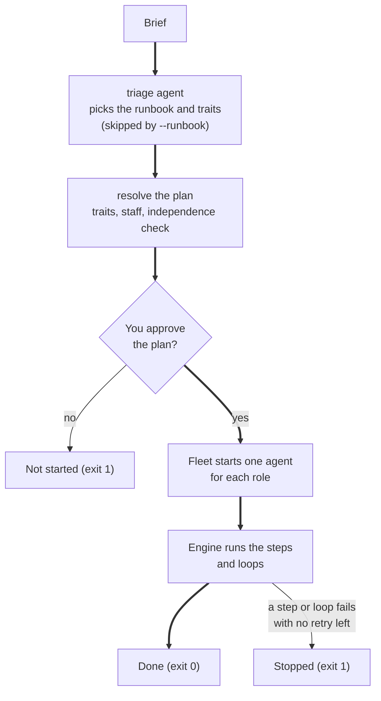
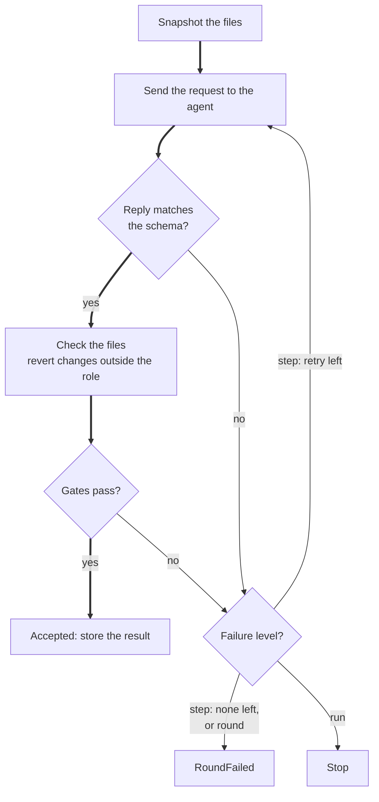

# factory

A software factory that runs a runbook of A2A agents. It builds web apps, writes research reports, audits code and designs APIs.

An HTML version of this document is in `README.html`. It has the same content and the same diagrams.

To install the project, go to section 5. To check that it works, go to section 6.

## 1. Purpose

The factory turns a written brief into a checked deliverable. The deliverable is a tested web app, a cited research report, a code audit or an API design.

A runbook describes the work. A runbook is a YAML file in `runbooks/`. It lists the steps, the traits and the checks. Each step names the role that does it.

Each role is an A2A agent. The factory starts one agent process for each role that a plan needs. Each agent calls one LLM worker.

The engine sends a task to an agent and checks the result with gates. A gate is a check that the engine runs itself. The engine does not trust a claim that an agent makes. For example, it runs the tests itself and compares the counts.

The shipped runbooks are:

- **web-app** – specifies, tests, builds and verifies a React frontend, a FastAPI backend, or both.
- **research** – plans a question, investigates each sub-question, checks every quote and writes a reviewed report.
- **code-audit** – reviews existing code through four lenses and writes a prioritized report.
- **api-design** – turns a brief into a spec and an HTTP API contract, and a reviewer checks it.

A checker must use a different model than the author. The reviewer differs from the writer and from the architect. The verifier differs from the developer. The factory refuses a plan that breaks this rule.

Each run works in its own folder, `apps/<name>/`. Runs with different names do not share files or ports.

## 2. Where to find the code

The line numbers apply to this version of the files. If a line number is different, search for the name.

| Item | File | Line |
|------|------|------|
| `AGENTS_FILE` – the default `agents.yaml` | `src/factory/cli.py` | 34 |
| `parse_traits()` – reads `--trait NAME=yes\|no` | `src/factory/cli.py` | 38 |
| `parse_staff()` – reads `--staff ROLE=WORKER[:MODEL]` | `src/factory/cli.py` | 48 |
| `cmd_runbooks()` – the `runbooks` command | `src/factory/cli.py` | 63 |
| `cmd_plan()` – the `plan` command | `src/factory/cli.py` | 73 |
| `cmd_run()` – the `run` command | `src/factory/cli.py` | 83 |
| `main()` – the argument parser and the error exit | `src/factory/cli.py` | 123 |
| `holds()` – tests a trait condition | `src/factory/runbook.py` | 62 |
| `fill()` – fills `{{ variable }}` in a text | `src/factory/runbook.py` | 88 |
| `StaffDef` – a staff entry: worker, model, url | `src/factory/runbook.py` | 121 |
| `StepDef` – the fields of a step | `src/factory/runbook.py` | 127 |
| `LoopDef` – the fields of a loop | `src/factory/runbook.py` | 155 |
| `Runbook` – the fields of a runbook, and its checks | `src/factory/runbook.py` | 166 |
| `load_runbook()` – reads one runbook file | `src/factory/runbook.py` | 246 |
| `catalog()` – loads every runbook in a folder | `src/factory/runbook.py` | 256 |
| `load_staff()` – maps each role to a worker and model | `src/factory/runbook.py` | 289 |
| `Plan` – a runbook with its traits and staff resolved | `src/factory/runbook.py` | 312 |
| `resolve()` – builds a plan | `src/factory/runbook.py` | 334 |
| `_check_independence()` – the checker rule | `src/factory/runbook.py` | 365 |
| `outline()` – the text of a plan | `src/factory/runbook.py` | 378 |
| `mermaid()` – the flowchart of a plan | `src/factory/runbook.py` | 413 |
| `APP_NAME` – the rule for a run name | `src/factory/schemas.py` | 20 |
| `MAX_CONVERSATION` – the limit of turns at one checkpoint | `src/factory/engine.py` | 38 |
| `API_PREFIX` – the path prefix of a full-stack contract | `src/factory/engine.py` | 39 |
| `Stop` – ends the run | `src/factory/engine.py` | 42 |
| `RoundFailed` – ends a round | `src/factory/engine.py` | 46 |
| `open_workspace()` – creates and locks `apps/<name>` | `src/factory/engine.py` | 57 |
| `snapshot()` – reads every project file | `src/factory/engine.py` | 84 |
| `changed()` – lists the files that differ | `src/factory/engine.py` | 93 |
| `restore()` – puts files back | `src/factory/engine.py` | 97 |
| `RunLog` – writes `run.json` | `src/factory/engine.py` | 109 |
| `Engine` – runs a plan | `src/factory/engine.py` | 147 |
| `run()` – the driver of a run | `src/factory/engine.py` | 165 |
| `loop()` – runs the rounds of a loop | `src/factory/engine.py` | 197 |
| `step()` – runs the items of a step | `src/factory/engine.py` | 223 |
| `attempt()` – runs one item with retries | `src/factory/engine.py` | 251 |
| `_request()` – builds the task for an agent | `src/factory/engine.py` | 288 |
| `_schema_ctx()` – the context for a schema | `src/factory/engine.py` | 327 |
| `_on_input()` – asks the person | `src/factory/engine.py` | 334 |
| `_check_files()` – reverts changes outside a role | `src/factory/engine.py` | 357 |
| `_review_test_change()` – the tester judges a test change | `src/factory/engine.py` | 379 |
| `_reset_scaffolds()` – resets the scaffolds before code is written | `src/factory/engine.py` | 453 |
| `triage()` – asks the triage agent for a choice | `src/factory/engine.py` | 538 |
| `Failure` – a failed gate, with a level | `src/factory/gates.py` | 36 |
| `GATES` – the table of gates | `src/factory/gates.py` | 64 |
| `run_tests()` – runs the suite of a surface | `src/factory/gates.py` | 124 |
| `free_port()` – asks the system for a free port | `src/factory/gates.py` | 143 |
| `serve_vite()` – builds and previews a frontend | `src/factory/gates.py` | 175 |
| `serve_asgi()` – starts a backend with uvicorn | `src/factory/gates.py` | 197 |
| `tests_named()` – gate: a test for each criterion | `src/factory/gates.py` | 238 |
| `tests_red()` – gate: new tests fail | `src/factory/gates.py` | 257 |
| `tests_green()` – gate: all tests pass | `src/factory/gates.py` | 269 |
| `counts_match()` – gate: the counts agree | `src/factory/gates.py` | 278 |
| `serves()` – gate: the build serves | `src/factory/gates.py` | 287 |
| `criteria_covered()` – gate: every criterion passes | `src/factory/gates.py` | 296 |
| `fetch_text()` – fetches a page as text | `src/factory/gates.py` | 316 |
| `quote_on_page()` – finds a quote on a page | `src/factory/gates.py` | 336 |
| `citations_verified()` – gate: quotes are on their pages | `src/factory/gates.py` | 342 |
| `sources_cited()` – gate: the report cites verified sources | `src/factory/gates.py` | 368 |
| `evidence_verified()` – gate: evidence is in the code | `src/factory/gates.py` | 379 |
| `review_approves()` – gate: the reviewer approves | `src/factory/gates.py` | 404 |
| `START_TIMEOUT` – the wait for an agent card | `src/factory/fleet.py` | 22 |
| `Fleet` – starts and stops the agents | `src/factory/fleet.py` | 25 |
| `_wait()` – waits for a card and checks its tags | `src/factory/fleet.py` | 54 |
| `send()` – sends a task to a role | `src/factory/fleet.py` | 80 |
| `LLM_ATTEMPTS` – the tries for a usable reply | `src/factory/agent.py` | 43 |
| `extract_json()` – reads the last JSON block | `src/factory/agent.py` | 46 |
| `prompt_for()` – builds the prompt of a task | `src/factory/agent.py` | 60 |
| `produce()` – calls the worker and validates the reply | `src/factory/agent.py` | 91 |
| `handle()` – turns a reply into questions, a review or a result | `src/factory/agent.py` | 106 |
| `card_for()` – the agent card with its tags | `src/factory/agent.py` | 119 |
| `main()` – starts one agent | `src/factory/agent.py` | 127 |
| `CODEX_TIMEOUT` – the limits of one LLM call | `src/factory/invoke.py` | 20 |
| `Tools` – the tools of a role in a folder | `src/factory/invoke.py` | 24 |
| `claude_allowlist()` – the Claude tool flags | `src/factory/invoke.py` | 36 |
| `invoke()` – runs Claude or Codex | `src/factory/invoke.py` | 43 |
| `SEARCH` – the command line of the factory search | `src/factory/roles.py` | 30 |
| `Role` – one role | `src/factory/roles.py` | 39 |
| `_RoleDef` – the checked form of a role in the file | `src/factory/roles.py` | 57 |
| `load_roles()` – reads `roles.yaml` | `src/factory/roles.py` | 70 |
| `ROLES` – the roles, loaded on first use | `src/factory/roles.py` | 124 |
| `ConfigError` – a settings error | `src/factory/config.py` | 39 |
| `Budgets` – the cost and retry limits | `src/factory/config.py` | 107 |
| `Config` – the checked `llm.yaml` | `src/factory/config.py` | 128 |
| `worker()` – finds a worker by name | `src/factory/config.py` | 176 |
| `load_config()` – reads `llm.yaml` and fills the variables | `src/factory/config.py` | 271 |
| `MODELS` – the schema of each deliverable | `src/factory/schemas.py` | 156 |
| `SHAPES` – the reply format shown to an agent | `src/factory/schemas.py` | 169 |
| `validate()` – checks a reply | `src/factory/schemas.py` | 198 |
| `_check_contract()` – checks the API contract paths | `src/factory/schemas.py` | 240 |
| `render()` – shows a deliverable as text | `src/factory/schemas.py` | 286 |
| `Template` – a scaffold and its metadata | `src/factory/scaffold.py` | 36 |
| `read_template()` – reads `templates/<name>.yaml` | `src/factory/scaffold.py` | 49 |
| `install()` – installs the dependencies of a scaffold | `src/factory/scaffold.py` | 77 |
| `place()` – copies a scaffold into a run | `src/factory/scaffold.py` | 88 |
| `reset()` – returns a scaffold to its template | `src/factory/scaffold.py` | 99 |
| `TIMEOUT` – the wait for one search source | `src/factory/search.py` | 23 |
| `SOURCES` – the search sources | `src/factory/search.py` | 88 |
| `DEFAULT_SOURCES` – the sources used when `--sources` is absent | `src/factory/search.py` | 92 |
| `search()` – queries the sources in parallel | `src/factory/search.py` | 95 |
| `Reply` – a reply from an agent | `src/factory/a2a_transport.py` | 47 |
| `StageFailed` – a task that did not finish | `src/factory/a2a_transport.py` | 55 |
| `agent_card()` – builds an agent card | `src/factory/a2a_transport.py` | 99 |
| `build_app()` – builds the agent server | `src/factory/a2a_transport.py` | 119 |
| `fetch_card()` – reads an agent card | `src/factory/a2a_transport.py` | 127 |
| `call()` – sends a task and handles input requests | `src/factory/a2a_transport.py` | 133 |
| `ROLES_FILE` – the default `roles.yaml` | `src/factory/paths.py` | 10 |
| `CMD_TIMEOUT` – the limit of a command | `src/factory/process.py` | 9 |
| `workers:` – the LLM workers | `llm.yaml` | 21 |
| `reviewer:` – the reviewer candidates | `llm.yaml` | 49 |
| `budgets:` – the cost and retry limits | `llm.yaml` | 53 |
| `roles:` – who plays each role | `agents.yaml` | 10 |
| `roles:` – the definition of each role | `roles.yaml` | 17 |
| `rounds:` – the rounds of the research write loop | `runbooks/research.yaml` | 49 |

## 3. How it works

### 3.1 A run from brief to result

The command `factory run` takes a brief. It asks the triage agent to pick a runbook and its traits. The option `--runbook` skips this choice. The engine then runs the steps of the plan.



**Figure 1.** A run from brief to result. The thick line is a run that passes every check. The option `--yes` skips the approval.

The command `factory plan` shows the same plan without a run. The option `--mermaid` prints the flowchart of the plan.

A run uses these steps:

1. Load the settings, the runbooks and the staff.
2. Resolve the plan. The plan must pass the checker rule.
3. Ask you to approve the plan.
4. Create and lock `apps/<name>/`.
5. Start one agent for each role in the plan.
6. Place the scaffolds, then run the steps and loops in order.
7. Write `run.json` and stop the agents.

### 3.2 One attempt at a step

A step runs once for each item. An item is a surface, a list entry or an entry of an earlier result. The method `attempt()` runs one item.



**Figure 2.** One attempt at a step. The thick line is an attempt that passes. A retry sends the failure message back as feedback.

Every failure has a level. The level decides what happens next.

| Level | What happens | Set by |
|-------|--------------|--------|
| `step` | The engine retries the attempt with the message as feedback. The default level. | A reply that does not match the schema, a task that did not finish, and most gates |
| `round` | The attempt ends with `RoundFailed`. The loop starts a new round. | `tests_green`, `serves`, `review_approves` |
| `run` | The engine raises `Stop`. The run ends. | `criteria_covered` |

A step has `retries`. The default is 1, so a step has 2 attempts. After the last attempt, the item ends with `RoundFailed`.

Outside a loop, a `RoundFailed` ends the run.

### 3.3 Loops and rounds

A loop groups steps that repeat until they pass. The setting `rounds` gives the number of rounds. The value `budget` means 1 + `budgets.max_retries`. With the shipped settings, that is 2 rounds. The research `write` loop sets `rounds: 3`.

A failed round gives its feedback to the first step of the next round. If the failed step runs for each surface, only the failed surfaces run again.

A loop can have `gates`. They run after all steps of a round pass. If every round fails, the engine raises `Stop` with the last problem.

### 3.4 Gates

| Gate | What it checks | Level |
|------|----------------|-------|
| `tests_named` | Each criterion of the surface has a test named after it. No test is skipped, focused or marked todo. | `step` |
| `tests_red` | The new tests load and at least one fails. | `step` |
| `tests_green` | The suite loads and no test fails. | `round` |
| `serves` | The build serves: `vite build` and preview, or uvicorn answering `/openapi.json`. | `round` |
| `counts_match` | The counts of the verifier equal the counts of the engine run. | `step` |
| `criteria_covered` | Every criterion has a verdict that starts with `PASS`. | `run` |
| `citations_verified` | Each finding quote is on the page that it cites. The gate drops the others. | `step` |
| `sources_cited` | The report links every verified source and no other source. | `step` |
| `evidence_verified` | Each audit finding has its evidence near the cited line. The gate drops the others. | `step` |
| `review_approves` | The reviewer approved. Otherwise its issues go back to the author. | `round` |

The gates `citations_verified` and `evidence_verified` fail only when no finding survives. A quote must have 20 characters or more after normalization. The gate ignores case, punctuation, spacing and citation markers such as `[1]`.

The gate `evidence_verified` searches 5 lines before and 5 lines after the cited line.

### 3.5 Roles, staffing and tools

A role is a block in `roles.yaml`. The file `agents.yaml` says which worker plays each role. A runbook can override this with its own `staff:` block. The option `--staff ROLE=WORKER[:MODEL]` overrides both for one run.

| Role | Does | Default worker | Tools |
|------|------|----------------|-------|
| `triage` | Picks the runbook, the traits and a name. | `claude-agent-sdk` | none |
| `analyst` | Turns a brief into a spec or a research plan. Asks questions. | `claude-agent-sdk` | none |
| `architect` | Designs the API contract. | `claude-agent-sdk` | none |
| `tester` | Writes the tests first. Judges a test change. | `codex-gpt` | edit, test |
| `developer` | Builds the code that passes the tests. | `codex-gpt` | edit, test, build |
| `verifier` | Runs the tests and judges each criterion. | `codex-gemini` | test |
| `researcher` | Answers one sub-question with quoted sources. | `claude-agent-sdk` | web, search, curl |
| `auditor` | Reviews code through one lens. | `claude-agent-sdk` | none |
| `writer` | Writes the report from verified material. | `claude-agent-sdk` | none |
| `reviewer` | Approves a deliverable or sends it back. | `codex-gpt` | none |

Every role can read files. The class `Role` maps its fields to tools:

- Claude gets `--allowedTools`. The list holds `Read`, `Glob` and `Grep`. The field `edit` adds `Edit` and `Write`. The field `web` adds `WebFetch`. Each command adds `Bash(<command>:*)`.
- Codex gets the sandbox `read-only`. A role with `edit` or a command gets `workspace-write`. The commands `search` and `curl` also open network access.

The checker rule compares models. The reviewer must differ from the writer and from the architect. The verifier must differ from the developer. The rule applies to a pair only when both roles are in the plan. The setting `reviewer.must_differ_from_author` turns the rule on. It is on by default.

### 3.6 Agents and the A2A transport

The class `Fleet` starts one process for each role. The command is `python -m factory.agent ROLE --worker W --model M --port N --config C`. The port comes from `free_port()`. The log goes to `.factory/agents/<role>.log`.

The fleet waits up to 30 seconds for each agent card. It checks that the card has the tags `role:`, `worker:` and `model:` with the expected values. If a staff entry has `url:`, the fleet uses that agent and does not start one.

An agent handles a task in this order:

1. Build the prompt from the role, the stack, the task, the context and the feedback.
2. Call the worker. The function `invoke()` runs `codex` or `claude`.
3. Read the last `json` block of the reply.
4. Validate it against the schema of the step.
5. If the reply is not usable, call the worker once more with the error.

The agent makes at most 2 calls (`LLM_ATTEMPTS`). The function `call()` has no read timeout. Each LLM call has its own limit: 900 seconds for Codex and 1500 seconds for Claude.

### 3.7 Checkpoints and questions

A step with `checkpoint: true` shows its result to you before the engine uses it. The analyst can also ask questions. Both use the task state `input-required`.

- For questions, type an answer. Press Enter to let the agent decide.
- For a review, press Enter to accept. Type text to ask for changes.
- After 6 turns at one checkpoint, the next turn stops the run (`MAX_CONVERSATION`).
- A parallel step never pauses for a person.
- With `--yes`, no question appears. The agent decides, and the engine accepts every checkpoint.

### 3.8 Files a run writes

The engine takes a snapshot of the files before each attempt. After the attempt, it compares the files. A role with `writes: none` must not change files. The engine reverts such changes and goes on. A role with `writes: tests` or `writes: source` can change only the files that the template allows. A change outside that set is reverted, and the attempt fails.

A developer can change a test only with a stated reason. The tester reviews the change. The engine reverts the change if the tester does not approve it.

The first step that writes code resets each scaffold to its template. The reset keeps `node_modules` and `.venv`.

| Path in `apps/<name>/` | Content |
|------------------------|---------|
| `.factory/run.json` | The status, the staff, and one event for each attempt |
| `.factory/artifacts.json` | The result of every step |
| `.factory/lock` | The lock that stops a second run with the same name |
| `.factory/agents/<role>.log` | The log of one agent |
| `SPEC.json`, `API.json`, `PLAN.json` | Results that a step saves with `save:` |
| `REPORT.md`, `AUDIT.md` | Reports that a step saves with `save:` |
| `web/`, `api/` | The scaffolds of a web app |

The status in `run.json` is `running`, `accepted`, `stopped` or `error`. A second run with the same name needs `--rebuild` after an accepted run.

## 4. Settings

### 4.1 llm.yaml

The file `llm.yaml` holds the endpoints, the workers, the allowed models and the budgets. The text `${VAR}` takes its value from the environment. The loader rejects a literal key.

| Setting | Shipped value | Effect |
|---------|---------------|--------|
| `llm.base_url` | `${ANTHROPIC_BASE_URL}` | The default endpoint of a worker |
| `llm.api_key_env` | `ANTHROPIC_AUTH_TOKEN` | The name of the variable that holds the key |
| `llm.wire_api` | `anthropic-messages` | The default protocol |
| `llm.allowed_models` | `${ANTHROPIC_MODEL}`, `gpt-6.1-sol`, `gemini-3.6-flash` | Every model must be in this list |
| `llm.default_model` | `${ANTHROPIC_MODEL}` | The default model |
| `workers.<name>.enabled` | `true` for all 3 workers | A disabled worker needs no variables |
| `workers.<name>.harness` | `claude-agent-sdk` or `codex` | The command that runs the worker |
| `workers.<name>.models` | one model each | The models that the worker serves |
| `reviewer.candidates` | `gpt-6.1-sol`, `${ANTHROPIC_MODEL}`, `gemini-3.6-flash` | Checked at load time only. Each must be an allowed model, and two must be served by enabled workers. No run picks a reviewer from them. |
| `reviewer.must_differ_from_author` | `true` | Turns on the checker rule |
| `budgets.per_task_usd` | `30` | The cost limit of one Claude call |
| `budgets.per_day_usd` | not set | No code reads it |
| `budgets.max_retries` | `1` | A `budget` loop has 1 + this many rounds |

### 4.2 agents.yaml

The file `agents.yaml` maps each role to a worker. The shipped map is in the table in section 3.5. A staff entry can also set `model:` and `url:`.

### 4.3 roles.yaml

The file `roles.yaml` defines the roles. The loader checks the file when it loads. A bad file gives `error: ...` and exit code 2.

| Field | Default | Effect |
|-------|---------|--------|
| `title` | required | The short name in plans and output |
| `description` | required | One sentence on the agent card |
| `prompt` | required | The standing instructions. The text `{search}` becomes the search command. |
| `edit` | `false` | The role can create and change files |
| `web` | `false` | The role can fetch web pages |
| `runs` | none | The commands the role can run: `test`, `build`, `search`, `curl` |
| `asks` | `false` | The role can pause to ask you questions |

The variable `FACTORY_ROLES` names another roles file. The agents that the fleet starts inherit it.

### 4.4 Runbook fields

| Field | Default | Effect |
|-------|---------|--------|
| `role` | required | The role that does the step |
| `instructions` | required | The task, with `{{ brief }}`, `{{ item.* }}` and similar variables |
| `when` | always | A trait condition such as `frontend and backend` |
| `for_each` | none | `surfaces`, a list, or `<step>.<field>` |
| `parallel` | `false` | Runs the items together, at most 6 at a time |
| `reads` | none | The earlier results that the agent gets as context |
| `output` | none | The schema that the reply must match |
| `gates` | none | The checks that the engine runs |
| `checkpoint` | `false` | You review the result |
| `save` | none | The file that receives the result |
| `retries` | `1` | The extra attempts after a failure |
| `cwd` | `surface` or `workspace` | The folder where the agent works. `target` is also allowed. |
| `writes` | `none` | `none`, `tests` or `source` |
| `rounds` (loop) | `budget` | The rounds of a loop |

### 4.5 Command-line options

| Command or option | Effect |
|-------------------|--------|
| `factory runbooks` | Lists the runbooks and when to use each |
| `factory plan RUNBOOK` | Shows the plan without a run |
| `--mermaid` (plan) | Prints a Mermaid flowchart |
| `factory run --brief TEXT` | Runs the factory. The option `--brief` is required. |
| `--runbook NAME` | Skips triage |
| `--trait NAME=yes\|no` | Sets a trait. Repeat it for more traits. |
| `--staff ROLE=WORKER[:MODEL]` | Sets who plays a role |
| `--name NAME` | Works in `apps/NAME` |
| `--target PATH` | The code to audit |
| `--rebuild` | Redoes accepted work |
| `--yes` | Asks nothing and accepts every checkpoint |
| `--config`, `--agents`, `--runbooks` | Use other settings files |

### 4.6 Environment variables

| Variable | Used for |
|----------|----------|
| `ANTHROPIC_BASE_URL`, `ANTHROPIC_AUTH_TOKEN`, `ANTHROPIC_MODEL` | The `claude-agent-sdk` worker |
| `OPENAI_BASE_URL`, `OPENAI_API_KEY` | The `codex-gpt` worker |
| `GOOGLE_GEMINI_BASE_URL`, `GEMINI_API_KEY` | The `codex-gemini` worker |
| `FACTORY_ROLES` | Another roles file |

### 4.7 Fixed constants

| Constant | Value | Effect |
|----------|-------|--------|
| `START_TIMEOUT` | 30 seconds | The wait for an agent card |
| `CODEX_TIMEOUT` | 900 seconds | The limit of one Codex call |
| `CLAUDE_TIMEOUT` | 1500 seconds | The limit of one Claude call |
| `LLM_ATTEMPTS` | 2 | The calls for a usable reply |
| `MAX_CONVERSATION` | 6 | The turns at one checkpoint |
| `CMD_TIMEOUT` | 300 seconds | The limit of a test or build command |
| `TIMEOUT` (search) | 12 seconds | The wait for one search source |
| `API_PREFIX` | `/api/` | The path prefix of a full-stack contract |
| `APP_NAME` | 1 to 40 characters | Lowercase letters, digits and hyphens |

## 5. Install

### 5.1 Before you start

You need:

- Python 3.11 or later.
- `uv`.
- `codex` and `claude` on your `PATH`.
- `npm`, if you build a frontend.
- The environment variables in section 4.6.

### 5.2 Install the dependencies

```bash
uv sync
```

### 5.3 Check that the install worked

```bash
uv run pytest
uv run factory runbooks
```

The test run must print `124 passed`. The second command must list `api-design`, `code-audit`, `research` and `web-app`. Neither command calls an LLM.

### 5.4 Run the factory

```bash
uv run factory plan web-app --trait backend=yes
uv run factory run --brief "a shared shopping list for my family"
uv run factory run --brief "which vector database fits a 10M-document RAG system?"
uv run factory run --runbook code-audit --target apps/kanban-react --brief "is it ready to ship?"
```

A run calls the LLM workers and takes minutes. The factory shows the plan and waits for your approval.

### 5.5 Change the settings

- To change who plays a role, edit `agents.yaml`, or use `--staff` for one run.
- To change a prompt or a capability, edit `roles.yaml`.
- To add a kind of work, add a file to `runbooks/`.
- To switch a worker off, set `enabled: false` in `llm.yaml`. A role that needs it must use another worker.

## 6. Validate

### 6.1 Level 1: unit tests

```bash
uv run pytest
```

Last line of the real run:

```
============================= 124 passed in 2.06s ==============================
```

The engine tests use fake agents. No test calls an LLM or the network.

### 6.2 Level 2: plans without a run

```bash
uv run factory plan web-app --trait backend=yes
```

The real output starts with these lines:

```
Runbook web-app: Build a web app
Traits: frontend=yes, backend=yes
Scaffolds: web/ (react-vite), api/ (fastapi)
```

The next lines show the steps: spec, contract, tests for each surface, and the loop `build` with develop and verify.

### 6.3 Level 3: a live run

A live run needs the workers and the network. This document quotes no output from a live run. No person has done this check for this document yet.

### 6.4 What each test file proves

| File | Tests | What it proves |
|------|-------|----------------|
| `tests/test_a2a_transport.py` | 5 | A task returns its result, asks for input on the same task, fails with a reason, and serves its card. |
| `tests/test_config.py` | 29 | `llm.yaml` loads, rejects literal keys and unknown models, and needs two reviewer candidates when the checker rule is on. |
| `tests/test_engine.py` | 24 | Gates, retries, rounds, role checks, checkpoints, triage and the workspace lock work with fake agents. |
| `tests/test_roles.py` | 17 | `roles.yaml` loads, rejects bad files with a reason, and can be replaced with `FACTORY_ROLES`. |
| `tests/test_runbooks.py` | 28 | The shipped runbooks load, traits resolve, conditions are safe, and bad runbooks are refused. |
| `tests/test_schemas.py` | 17 | Each deliverable schema accepts good data, rejects bad data and renders as text. |

### 6.5 Problems and solutions

| Problem | Cause | Solution |
|---------|-------|----------|
| `error: environment variables not set: ...` | A `${VAR}` in `llm.yaml` has no value. | Set the variables in section 4.6. |
| `error: no runbook 'x'; runbooks are ...` | The runbook name is wrong. | Run `factory runbooks`. |
| `... both use <model>; the reviewer must use a different model` | A checker and its author share a model. | Change `agents.yaml` or use `--staff`. |
| `apps/<name> already holds accepted work` | A run with this name finished. | Add `--rebuild`, or choose another `--name`. |
| `<name> is already being worked on by another run` | Another process holds the lock. | Wait for that run, or choose another `--name`. |
| `factory.search: unrecognized arguments` | `--sources` got a space-separated list. | Write `--sources wikipedia,openalex`. |
| A search source returns HTTP 429 | The public API limits the rate. | Wait and try again. The other sources still answer. |
| `needs --target, an existing directory` | The `code-audit` runbook has no target. | Add `--target PATH`. |
| `error: ... roles.yaml ...` | The roles file is not valid. | Read the reason in the message and fix the file. |
| Claude Code warns about an unknown model | The gateway model name is not in its list. | Ignore the warning. The call works. |

## 7. Known limits

- **A run can end with a draft.** In the `research` runbook, the `report` step saves `REPORT.md` before the `review` step runs. If the reviewer does not approve in 3 rounds, the run stops with status `stopped`. The last draft stays on disk. In 3 live runs, this happened.
- **Port race.** `free_port()` closes its socket before the agent binds the port (`gates.py` line 143). Another process can take the port. The fleet then gives up after 30 seconds (`fleet.py` line 22).
- **The card check is weak.** The fleet compares only the tags `role:`, `worker:` and `model:` (`fleet.py` line 54). A different agent with the same tags passes.
- **Agents keep state in memory.** `InMemoryTaskStore` (`a2a_transport.py` line 122) loses a task when the agent stops. A task cannot resume.
- **Same folder.** The task carries the path of the workspace. An agent at a `url:` must see the same folder.
- **Codex has no command list.** Any command makes the Codex sandbox writable (`invoke.py` line 46). The engine reverts the writes of a role with `writes: none` after the attempt (`engine.py` line 357).
- **The cost limit covers Claude only.** `per_task_usd` goes to the Claude command (`invoke.py` line 59). The Codex command has no cost limit. No code reads `per_day_usd` (`config.py` line 109).
- **The reviewer candidates are not used in a run.** The reviewer model comes from `agents.yaml` and the roles. `reviewer.candidates` is only validated when `llm.yaml` loads. The checker rule uses `_check_independence()` (`runbook.py` line 365).
- **A test gap is not retried.** If the tests are green and a criterion is not `PASS`, the run stops (`gates.py` line 296).
- **Quotes under 20 characters fail.** `quote_on_page()` rejects them (`gates.py` line 338). The gate drops such a finding.
- **Search has no retry.** `search()` reports the error of a source and goes on (`search.py` line 95). A rate limit removes that source from the result.
- **Only 6 items run together.** A parallel step uses at most 6 threads (`engine.py` line 241).
- **No read timeout on a task.** A hung agent blocks the run until its LLM call reaches the limit (`a2a_transport.py` line 133).
- **No person has checked the HTML.** The checks in section 6 do not include a review of the page by a person.

## 8. Glossary

| Term | Meaning |
|------|---------|
| A2A | The agent-to-agent protocol. An agent serves a card and accepts tasks. |
| Agent | A process that plays one role and calls one worker. |
| Agent card | The description that an agent serves. Its tags show the role, worker and model. |
| Artifact | The saved result of a step. |
| Brief | The request that you write in your own words. |
| Checkpoint | A pause where you review a result. |
| Contract | The list of API endpoints with example bodies. |
| Criterion | One testable statement in a spec. It has an id such as `AC1`. |
| Engine | The code that runs a plan: steps, loops, retries, checks and checkpoints. |
| Fleet | The set of agent processes of one run. |
| Gate | A check that the engine runs itself on a result. |
| Harness | The command that runs a worker: `claude` or `codex`. |
| Item | One unit of a step, such as one surface or one sub-question. |
| Loop | A group of steps that repeat in rounds until they pass. |
| Plan | A runbook with its traits, staff and scaffolds resolved. |
| Role | A job in a runbook, such as `developer`. A block in `roles.yaml` defines it. |
| Round | One pass through the steps of a loop. |
| Runbook | A YAML file that describes one kind of work. |
| Scaffold | A template copied into a run, such as `web/` or `api/`. |
| Staff | The map from each role to a worker and a model. |
| Step | One task for one role, with an output and gates. |
| Surface | A part of a web app: `web` (frontend) or `api` (backend). |
| Template | A scaffold folder with its metadata in `templates/<name>.yaml`. |
| Trait | A yes-or-no choice that changes a runbook, such as `backend`. |
| Triage | The choice of a runbook and its traits for a brief. |
| Worker | An entry in `llm.yaml`: a harness, an endpoint and a list of models. |
| Workspace | The folder `apps/<name>/` of one run. |
