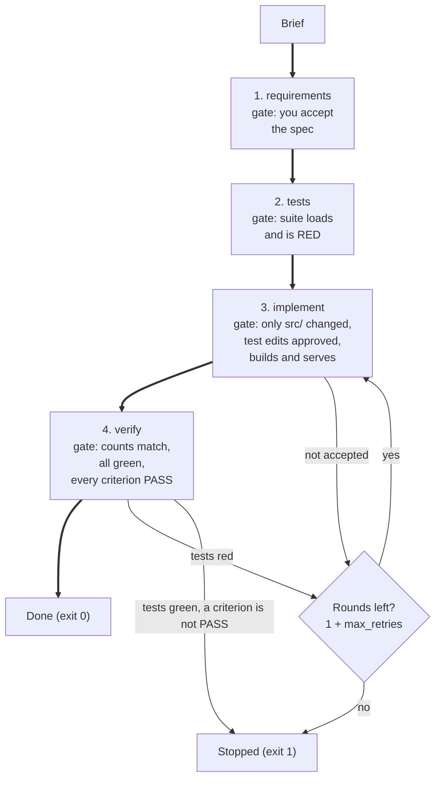
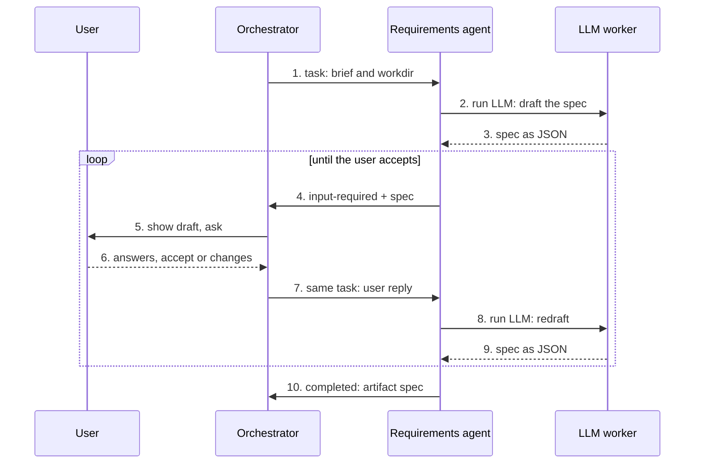
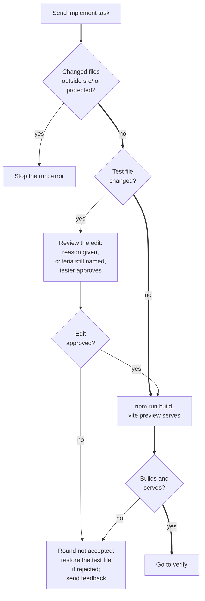

# a2a-poc

A proof of concept (POC) of a software factory. It builds a React app from a short brief through four A2A agents.

An HTML version of this document is in `pipeline-profile.html`. It has the same content and the same diagrams.

To install the project, go to section 5. To check that it works, go to section 6.

## 1. Purpose

A software factory turns a written brief into a tested web app. This project is a POC of one. It builds a React app in four stages. A separate A2A agent does each stage.

The orchestrator, `pipeline.py`, sends a task to each agent. The orchestrator checks each result with its own commands. It does not trust a count that an agent reports. For example, it runs Vitest itself and compares the counts.

The four stages are:

1. **requirements** – drafts a spec with acceptance criteria. You accept the spec.
2. **tests** – writes Vitest tests, at least one for each criterion, before the app exists.
3. **implement** – builds the app until the tests pass.
4. **verify** – runs the tests and checks that a passing test covers each criterion.

Each stage uses one LLM worker and one model. `pipeline.yaml` sets them. `llm.yaml` lists the workers and models that are allowed.

Each app is built in its own folder, `apps/<name>/`. A run writes `SPEC.json`, `src/` and `.factory/run.json` there. Runs for different apps do not share files or ports.

The folder `src/factory` holds the library: the config loader, the LLM command builders and the A2A transport. The folder `src/sample` holds the scripts: the orchestrator, the stage agents and two live checks.

## 2. Where to find the code

The line numbers apply to this version of the files. If a line number is different, search for the name.

| Item | File | Line |
|------|------|------|
| Constants (default app, app name rule, spec rounds, start timeout, protected files) | `src/sample/pipeline.py` | 58–72 |
| `Agents` – starts the stage agents, waits for their cards, stops them, sends tasks | `src/sample/pipeline.py` | 82 |
| `free_port()` – asks the system for a free port | `src/sample/pipeline.py` | 198 |
| `_wait_for_card()` – waits for the agent card and checks its tags | `src/sample/pipeline.py` | 113 |
| `snapshot()` – hashes every project file | `src/sample/pipeline.py` | 151 |
| `changed()` – lists the files that differ between two snapshots | `src/sample/pipeline.py` | 161 |
| `vitest()` – runs Vitest and reads its JSON report | `src/sample/pipeline.py` | 176 |
| `build_and_serve()` – builds the app and fetches it from `vite preview` | `src/sample/pipeline.py` | 209 |
| `RunLog` – writes `.factory/run.json` | `src/sample/pipeline.py` | 245 |
| `gather_requirements()` – stage 1 on the orchestrator side | `src/sample/pipeline.py` | 269 |
| `write_tests()` – stage 2 gate (loads, RED) | `src/sample/pipeline.py` | 307 |
| `review_test_change()` – the tester approves or rejects a test edit | `src/sample/pipeline.py` | 329 |
| `implement()` – stage 3 gate (files, test edit, build, serve) | `src/sample/pipeline.py` | 354 |
| `verify()` – stage 4 gate (counts match) | `src/sample/pipeline.py` | 372 |
| `reset_app()` – removes the generated files of an earlier run | `src/sample/pipeline.py` | 393 |
| `open_app()` – creates the app folder and takes the lock | `src/sample/pipeline.py` | 405 |
| The lock call `fcntl.flock` | `src/sample/pipeline.py` | 417 |
| `default_app_name()` – makes an app name from the brief | `src/sample/pipeline.py` | 433 |
| `prepare_workdir()` – runs `npm install` and checks the scaffold | `src/sample/pipeline.py` | 439 |
| `develop()` – the developer rounds and the final result | `src/sample/pipeline.py` | 451 |
| `main()` – command-line flags and the four stages | `src/sample/pipeline.py` | 487 |
| `CODEX_TIMEOUT`, `CLAUDE_TIMEOUT`, `LLM_ATTEMPTS` | `src/sample/stage_agents.py` | 50–51 |
| `ROLES` – agent titles and descriptions | `src/sample/stage_agents.py` | 53 |
| `STACK` – the fixed project stack in every prompt | `src/sample/stage_agents.py` | 64 |
| `SPEC_FORMAT` – the reply format for the spec | `src/sample/stage_agents.py` | 73 |
| `llm()` – runs the worker for one stage | `src/sample/stage_agents.py` | 89 |
| `draft_spec()` – asks the worker for a spec | `src/sample/stage_agents.py` | 127 |
| `requirements()` – handler of stage 1 | `src/sample/stage_agents.py` | 149 |
| `review_tests()` – the tester judges a test edit | `src/sample/stage_agents.py` | 174 |
| `tests()` – handler of stage 2 | `src/sample/stage_agents.py` | 204 |
| `implement()` – handler of stage 3 | `src/sample/stage_agents.py` | 247 |
| `verify()` – handler of stage 4 | `src/sample/stage_agents.py` | 285 |
| `HANDLERS` – stage name to handler | `src/sample/stage_agents.py` | 307 |
| `main()` – serves one stage (flags `stage`, `--stages`, `--port`) | `src/sample/stage_agents.py` | 310 |
| Paths and constants (`APPS`, `TEMPLATE`, `STAGE_NAMES`, `TEST_FILE`, `CMD_TIMEOUT`) | `src/sample/pipeline_common.py` | 15–23 |
| `Stage` – worker, model and url of a stage | `src/sample/pipeline_common.py` | 27 |
| `load_stages()` – reads and checks `pipeline.yaml` | `src/sample/pipeline_common.py` | 34 |
| `run()` – runs a command with stdin closed | `src/sample/pipeline_common.py` | 58 |
| `check_spec()` – checks a spec | `src/sample/pipeline_common.py` | 76 |
| `check_test_file()` – every criterion has a named test, no skips | `src/sample/pipeline_common.py` | 91 |
| `Reply` – the result of a handler | `src/factory/a2a_transport.py` | 47 |
| `StageFailed` – the task failed or cannot continue | `src/factory/a2a_transport.py` | 55 |
| `_Executor` – keeps the turns of each task | `src/factory/a2a_transport.py` | 64 |
| `execute()` – runs the handler and sets the task state | `src/factory/a2a_transport.py` | 69 |
| `agent_card()` – builds the agent card | `src/factory/a2a_transport.py` | 99 |
| `build_app()` – serves the card and the JSON-RPC route | `src/factory/a2a_transport.py` | 119 |
| `fetch_card()` – reads an agent card | `src/factory/a2a_transport.py` | 127 |
| `call()` – sends a task and answers `input-required` | `src/factory/a2a_transport.py` | 133 |
| `ConfigError` – the config file is invalid | `src/factory/config.py` | 39 |
| `Budgets` – `per_task_usd`, `per_day_usd`, `max_retries` | `src/factory/config.py` | 107 |
| `Config` – the checked config | `src/factory/config.py` | 128 |
| `check_request()` – checks a worker and model | `src/factory/config.py` | 194 |
| `reviewer_for()` – picks a reviewer model | `src/factory/config.py` | 212 |
| `_interpolate()` – replaces `${VAR}` | `src/factory/config.py` | 246 |
| `load_config()` – loads and checks `llm.yaml` | `src/factory/config.py` | 286 |
| `codex_argv()` – builds the `codex exec` command | `src/factory/codex.py` | 25 |
| `claude_env()` – builds the environment of a Claude worker | `src/factory/claude.py` | 16 |
| Block `llm` | `llm.yaml` | 11 |
| Block `workers` | `llm.yaml` | 21 |
| Block `reviewer` | `llm.yaml` | 48 |
| Block `budgets` | `llm.yaml` | 52 |
| Block `stages` | `src/sample/pipeline.yaml` | 11 |
| Live check of a Codex worker (`main`) | `src/sample/codex_live.py` | 18 |
| Live check of a Claude worker (`main`) | `src/sample/claude_live.py` | 19 |
| Tests | `tests/test_a2a_transport.py`, `tests/test_apps.py`, `tests/test_config.py`, `tests/test_test_amendments.py` | see 6.4 |

Other files:

- `templates/react-vite/` is the scaffold that `open_app()` copies into each new app.
- `src/sample/README.md` is a separate README for the scripts.
- `software-factory-prd.md` is a separate document. This README does not use it as a source.

## 3. How it works

### 3.1 The four stages and the gates

The orchestrator runs the stages in order. After each stage, it runs a gate. A gate is a check that the orchestrator does itself. A failed gate in stage 3 or 4 sends the problem back to the developer.



**Figure 1.** The four stages and their gates. The thick line is a run that passes every gate. A round is one pass through implement and verify.

| Stage | The agent does | The orchestrator gate | If the gate fails |
|-------|----------------|-----------------------|-------------------|
| 1. requirements | Asks questions. Drafts a spec. | `check_spec()` accepts the spec. You accept it. | You can ask for changes, and the agent drafts again. The 7th pause stops the run. Type `q` to quit. |
| 2. tests | Writes `src/App.test.jsx`. | Only that file changed. The suite loads. At least 1 test fails (RED). | The agent gets feedback and tries once more. A second failure stops the run. A change to another file stops the run at once. |
| 3. implement | Edits files under `src/`. | Only `src/` changed and no protected file changed. A test edit is approved. `npm run build` passes. `vite preview` serves the app. | The problem goes back to the developer as feedback. A change outside the role stops the run. |
| 4. verify | Runs the tests. Judges each criterion. | The reported counts equal the orchestrator Vitest counts. No test fails. Every verdict starts with `PASS`. | A failed test goes back to the developer. A changed file or a count mismatch stops the run. A green run with an uncovered criterion stops with exit code 1. |

The protected files are `package.json`, `package-lock.json`, `vite.config.js`, `index.html`, `src/main.jsx` and `src/setupTests.js`.

The number of rounds is `1 + budgets.max_retries`. With the shipped settings, that is 2 rounds.

### 3.2 Stage 1: the spec conversation

Stage 1 is one A2A task with several turns. The agent drafts a spec and then pauses in the state `input-required`. The orchestrator asks you, sends your reply on the same task, and the agent drafts again. The loop ends when you accept the spec.



**Figure 2.** The spec conversation. When the reply in step 7 is `accept`, the agent skips steps 8 and 9 and returns the accepted spec.

- A spec with open questions gives `kind: "questions"`. A spec without questions gives `kind: "review"`.
- With `--yes`, the orchestrator answers each question with a fixed text and accepts the first spec. The fixed text tells the agent to record its decision under `assumptions`.
- The orchestrator counts each `input-required` pause. The 7th pause stops the run (`MAX_SPEC_ROUNDS`).

### 3.3 A developer round

One round of stage 3 has the checks below. The gate for stage 4 follows only if the round is accepted.



**Figure 3.** One developer round. The thick line is the path with no test edit. A rejected test edit restores the test file as it was before the round.

The prompt allows the developer to edit the test file only to fix a test that is wrong. The prompt asks the developer to end the reply with `TEST CHANGE: none`, or `TEST CHANGE:` and the reason.

The orchestrator does not enforce that rule. It reviews each edit instead. A missing reason rejects the edit. A file that no longer names every criterion rejects the edit. The tester judges only an edit that passes both checks.

### 3.4 Messages between the orchestrator and the agents

Every request and result is a JSON object in an A2A data part. The table shows the shapes that `stage_agents.py` documents.

| Stage | Request | Result |
|-------|---------|--------|
| requirements | `{brief, workdir}` | Pauses with `{kind: "questions", questions, spec}`, answered by `{answers}`. Pauses with `{kind: "review", spec}`, answered by `{accept: true}` or `{accept: false, changes}`. Ends with `{spec}`. |
| tests | `{spec, workdir, feedback}` | Writes `src/App.test.jsx`. Returns `{path, tests}`. |
| tests, review mode | `{mode: "review", spec, workdir, before, after, reason}` | `{approved, reason}` |
| implement | `{workdir, feedback}` | Edits `src/`. Returns `{summary, test_change}`. |
| verify | `{workdir}` | `{passed, failed, verdicts}` |

### 3.5 How a run starts and stops

1. `main()` loads `llm.yaml` and `pipeline.yaml`. Each stage must name an enabled worker and an allowed model.
2. `open_app()` checks the app name and creates `apps/<name>/.factory/`.
3. `open_app()` takes a lock on `apps/<name>/.factory/lock` with `fcntl.flock`. A second run of the same app stops with an error.
4. The system releases the lock when the process ends, so a crashed run leaves no stale lock.
5. `open_app()` copies the template if `package.json` is missing. An app that has a `SPEC.json` stops the run unless you pass `--rebuild`.
6. `prepare_workdir()` runs `npm install` if `node_modules` is missing. Then it checks that the protected files exist.
7. `Agents` gives each stage a free port. `free_port()` binds port 0, and the system picks the port. With `--no-launch`, the ports come from `pipeline.yaml` (9101 to 9104).
8. `Agents` starts one `stage_agents.py` process for each stage. It writes each log to `apps/<name>/.factory/agents/<stage>.log`.
9. `_wait_for_card()` waits up to 30 seconds for each agent card. It tries again every 0.3 seconds.
10. The card must have the tags `stage:<name>`, `worker:<name>` and `model:<name>` for the stage. Other tags are allowed.
11. After stage 1, `reset_app()` deletes the generated files under `src/`. Then the orchestrator writes `SPEC.json`.
12. When the run ends, `Agents` sends a stop signal to the 4 processes. A process that is still alive after 10 seconds is killed.

A run starts 4 agent servers. Two runs at the same time start 8. Each gate in stage 3 also starts a `vite preview` server on a free port for a short time.

The test `test_each_run_gets_its_own_agent_ports` shows that two runs with 2 stages each get 4 different ports. This review did not run two apps at the same time.

Each run starts its own agents, so an agent serves one app. With `--no-launch`, runs share the agents. Then each task has its own list of turns, by task ID. Every LLM call starts a new process with a new prompt. The code passes no session ID and no resume flag. Each request carries its own workdir.

### 3.6 How an agent calls its LLM worker

`llm()` in `stage_agents.py` runs the worker of the stage. The harness decides how.

| Harness | Command | Timeout |
|---------|---------|---------|
| `codex` | `codex exec --ignore-user-config -s <sandbox> -m <model> -c <provider settings> -C <workdir> --skip-git-repo-check -- <prompt>` | 600 seconds |
| `claude-agent-sdk` | `claude -p <prompt> --model <model> --permission-mode acceptEdits --max-budget-usd <per_task_usd> --allowedTools <tools>` | 1200 seconds |

- Codex reads the API key from the environment variable that `api_key_env` names. The key is not on the command line.
- The sandbox is `workspace-write` if the stage edits files or runs commands. Otherwise it is `read-only`.
- The Claude process starts with only `HOME`, `PATH`, `ANTHROPIC_BASE_URL`, `ANTHROPIC_AUTH_TOKEN` and `ANTHROPIC_MODEL`.
- The Claude tools are `Read`, `Glob` and `Grep`. `Edit` and `Write` are added when the stage edits files. Each allowed command is added as `Bash(<command>)`.
- `run()` closes stdin. `codex exec` hangs on an open stdin.
- The spec, test, review and verify requests ask again after a reply with the wrong format. Each has 2 attempts (`LLM_ATTEMPTS`). The implement request has 1 attempt.

What each agent can do:

| Agent | Edits files | Allowed commands |
|-------|-------------|------------------|
| requirements | No | None |
| tests | No. The agent writes the test file itself. | None |
| tests, review mode | No | None |
| implement | Yes | `npm run build`, `npx vitest run` |
| verify | No | `npx vitest run` |

The command list applies only to Claude workers. A Codex worker can run any command in its writable sandbox. The shipped `pipeline.yaml` gives the tests, implement and verify stages to Codex workers.

### 3.7 Stored values

| Value | Where | Kept until |
|-------|-------|------------|
| Turns of a task | The memory of the agent process (`_Executor._turns`) | The task ends, fails or is cancelled |
| A2A tasks | The memory of the agent process (`InMemoryTaskStore`) | The agent process ends |
| Accepted spec | `apps/<name>/SPEC.json` | The next run of the same app writes it again |
| Run log | `apps/<name>/.factory/run.json` | The next run of the same app writes it again |
| Agent logs | `apps/<name>/.factory/agents/<stage>.log` | The next run of the same app writes them again |
| Lock | `apps/<name>/.factory/lock` | The run ends. The file stays; the lock does not. |
| Vitest report | `apps/<name>/.vitest-result.json` | The next call of `vitest()` deletes it |

Each event in `run.json` has these fields: `stage`, `agent`, `worker`, `model`, `seconds`, `outcome` and `detail`. The field `status` has one of these values: `accepted`, `failed`, `error` or `tests green, criteria not covered`.

### 3.8 Checks on llm.yaml

`load_config()` stops with a `ConfigError` for each case in the table.

| Case | Result |
|------|--------|
| A key named `api_key`, `apikey`, `token`, `secret`, `password` or `authorization` | Rejected |
| `api_key_env` is not the name of an environment variable | Rejected |
| A `${VAR}` that is unset or empty | Rejected, unless the worker is disabled |
| An enabled worker whose key variable is not set | Rejected |
| An unknown field | Rejected |
| A `version` other than 1 | Rejected |
| A `base_url` that is not an http or https URL | Rejected |
| A model that is not in `llm.allowed_models` | Rejected |
| A `default_model` that is not in the list of the worker | Rejected |
| All workers disabled | Rejected |
| `must_differ_from_author` with fewer than 2 reviewer models on enabled workers | Rejected |
| `per_task_usd` of 0 or less | Rejected |

`check_request()` raises `ModelNotAllowed` for an unknown worker, a disabled worker, or a model outside the allowed lists.

## 4. Settings

### 4.1 llm.yaml

| Setting | Value in the repository | Effect |
|---------|-------------------------|--------|
| `version` | `1` | The only version that `load_config()` accepts. |
| `llm.base_url` | `${ANTHROPIC_BASE_URL}` | The default gateway URL for each worker. |
| `llm.api_key_env` | `ANTHROPIC_AUTH_TOKEN` | The name of the variable that holds the default key. |
| `llm.wire_api` | `anthropic-messages` | The default protocol. The other value is `responses`. |
| `llm.allowed_models` | `${ANTHROPIC_MODEL}`, `gpt-6.1-sol`, `gemini-3.6-flash` | Every model that any worker can use. |
| `llm.default_model` | `${ANTHROPIC_MODEL}` | Must be in `allowed_models`. |
| `workers.claude-agent-sdk` | enabled, harness `claude-agent-sdk` | Runs `claude -p`. Model `${ANTHROPIC_MODEL}`. |
| `workers.codex-gpt` | enabled, harness `codex` | Runs `codex exec`. Model `gpt-6.1-sol`. Uses `OPENAI_BASE_URL` and `OPENAI_API_KEY`. |
| `workers.codex-gemini` | enabled, harness `codex` | Runs `codex exec`. Model `gemini-3.6-flash`. Uses `GOOGLE_GEMINI_BASE_URL` and `GEMINI_API_KEY`. |
| `workers.<name>.harness`, `models`, `default_model` | set for each worker | `llm()` supports the harnesses `codex` and `claude-agent-sdk`. A stage can request only a listed model. |
| `workers.<name>.enabled` | `true` | A disabled worker does not need its variables. |
| `reviewer.candidates` | `gpt-6.1-sol`, `${ANTHROPIC_MODEL}`, `gemini-3.6-flash` | Models for `reviewer_for()`. The pipeline does not call it. |
| `reviewer.must_differ_from_author` | `true` | The reviewer model must differ from the author model. |
| `budgets.per_task_usd` | `30` | The cost limit of one Claude call (`--max-budget-usd`). Codex calls have no such limit. |
| `budgets.max_retries` | `1` | The number of extra developer rounds. |
| `budgets.per_day_usd` | not set | The loader accepts it. No pipeline code reads it. |

A worker takes `base_url`, `api_key_env` and `wire_api` from the `llm` block unless it sets its own.

### 4.2 pipeline.yaml

| Stage | Worker | Model | Url (used with `--no-launch`) |
|-------|--------|-------|-------------------------------|
| `requirements` | `claude-agent-sdk` | the worker default | `http://127.0.0.1:9101` |
| `tests` | `codex-gpt` | the worker default | `http://127.0.0.1:9102` |
| `implement` | `codex-gpt` | the worker default | `http://127.0.0.1:9103` |
| `verify` | `codex-gemini` | the worker default | `http://127.0.0.1:9104` |

The file must have exactly these 4 stage keys. Each stage needs `worker` and `url`. `model` is optional. Each url must be `http://host:port`, and the 4 urls must differ.

### 4.3 Command-line flags

`src/sample/pipeline.py`:

| Flag | Default | Effect |
|------|---------|--------|
| `--brief` | the kanban board brief | What to build. |
| `--app` | `kanban-react` for the default brief. Otherwise the first 4 words of the brief, or `app` if it has none | The app name. The folder is `apps/<app>`. |
| `--rebuild` | off | Builds over an app that has a `SPEC.json`. |
| `--stages` | `src/sample/pipeline.yaml` | Other workers, models or urls. |
| `--spec` | none | Reuses an accepted spec and skips stage 1. |
| `--yes` | off | Accepts the spec without asking you. |
| `--no-launch` | off | Connects to agents that already run. |

`src/sample/stage_agents.py`:

| Argument | Default | Effect |
|----------|---------|--------|
| `stage` | required | One of `requirements`, `tests`, `implement`, `verify`. |
| `--stages` | `src/sample/pipeline.yaml` | The stages file. |
| `--port` | the port in the url | Serves on this port instead. |

An app name must match `[a-z0-9][a-z0-9-]{0,39}`: lowercase letters, digits and hyphens, at most 40 characters.

### 4.4 Environment variables

| Variable | Needed by |
|----------|-----------|
| `ANTHROPIC_BASE_URL` | `llm.yaml` (all workers that use the default) |
| `ANTHROPIC_AUTH_TOKEN` | `claude-agent-sdk` |
| `ANTHROPIC_MODEL` | `llm.yaml` (the model of `claude-agent-sdk`) |
| `OPENAI_BASE_URL` | `codex-gpt` |
| `OPENAI_API_KEY` | `codex-gpt` |
| `GOOGLE_GEMINI_BASE_URL` | `codex-gemini` |
| `GEMINI_API_KEY` | `codex-gemini` |

### 4.5 Fixed constants

| Constant | Value | File | Effect |
|----------|-------|------|--------|
| `MAX_SPEC_ROUNDS` | 6 | `pipeline.py` | The most `input-required` turns in stage 1. |
| `AGENT_START_TIMEOUT` | 30 seconds | `pipeline.py` | The wait for each agent card. |
| `RESULT_FILE` | `.vitest-result.json` | `pipeline.py` | The Vitest report file. |
| `IGNORED_DIRS` | `node_modules`, `dist`, `.factory` | `pipeline.py` | Folders that `snapshot()` skips. |
| `CODEX_TIMEOUT` | 600 seconds | `stage_agents.py` | The time limit of a Codex call. |
| `CLAUDE_TIMEOUT` | 1200 seconds | `stage_agents.py` | The time limit of a Claude call. |
| `LLM_ATTEMPTS` | 2 | `stage_agents.py` | Attempts for a reply with the wrong format. |
| `CMD_TIMEOUT` | 300 seconds | `pipeline_common.py` | The time limit of `npm` and `npx` commands. |
| `TEST_FILE` | `src/App.test.jsx` | `pipeline_common.py` | The only test file. |

## 5. Install

### 5.1 Before you start

You need:

- macOS or Linux. The code imports `fcntl`, which Windows does not have.
- Python 3.11 or later. This review used Python 3.13.0.
- `uv`. This review used uv 0.13.5.
- Node.js and `npm`. This review used Node.js v26.12.1 and npm 11.20.0. This document does not state a minimum version.
- The `codex` command. This review used codex-cli 0.164.0.
- The `claude` command. This review used Claude Code 2.1.316.
- Access to the LLM gateway, and the 7 environment variables in 4.4.

In this document, the **repository root** is the top folder of the repository, named `a2a-poc`. All commands start from that folder.

### 5.2 Install the dependencies

1. Open a terminal. Go to the repository root.
2. Run:

   ```bash
   uv sync
   ```

3. Set the 7 environment variables from 4.4.

This review ran `uv sync` in a clean copy of the tracked files. The install check and `uv run pytest` passed there. The repository `.venv` was not rebuilt. No person has done the install check on their own machine yet.

The first run of an app runs `npm install` in `apps/<name>/`. You do not run it yourself.

To use fewer workers, set `enabled: false` on a worker in `llm.yaml`. Then change each stage in `pipeline.yaml` that names it. A stage that names a disabled worker stops the run at the start. Keep at least 2 reviewer models on enabled workers. Otherwise `load_config()` fails.

### 5.3 Check that the install worked

Run:

```bash
uv run python -c "from factory import load_config; c = load_config('llm.yaml'); print(sorted(w.name for w in c.enabled_workers()))"
```

**Expected:** the output lists the enabled workers. This review printed:

```text
['claude-agent-sdk', 'codex-gemini', 'codex-gpt']
```

If a variable is missing, the command stops with a `ConfigError` that names it. See the table in 6.5.

### 5.4 Run the pipeline

Run these commands from the repository root. This review did not run them.

```bash
uv run python src/sample/pipeline.py --app todo --brief "a todo app with due dates"
uv run python src/sample/pipeline.py --app todo --brief "a todo app with due dates" --rebuild
uv run python src/sample/pipeline.py --app todo --brief "a todo app with due dates" --yes
uv run python src/sample/pipeline.py --app todo --spec apps/todo/SPEC.json --rebuild
```

- Line 1 builds the app and asks you about the spec.
- Line 2 builds over an app that has a `SPEC.json`.
- Line 3 accepts the first spec without asking you. Add `--rebuild` if `apps/todo` has a `SPEC.json`.
- Line 4 reuses an accepted spec and skips stage 1.

To build 2 apps at the same time, start 1 command for each app in its own terminal.

To open the app after a build, run `cd apps/<name> && npm run dev`.

To run the agents yourself, start each stage in its own terminal with `uv run python src/sample/stage_agents.py <stage>`. Then start the pipeline with `--no-launch`. Each agent serves on the url in `pipeline.yaml`.

### 5.5 Change the settings

1. Open `llm.yaml` or `src/sample/pipeline.yaml` in a text editor.
2. Change a value. Never write a key in `llm.yaml`. Write the name of an environment variable.
3. Run the install check in 5.3.
4. Run `uv run pytest`. The test `test_shipped_config_loads` loads the real `llm.yaml`.

## 6. Validate

To validate means to check that the project works as this document says. There are three levels.

| Level | What it proves | Time | Needs an LLM request |
|-------|----------------|------|----------------------|
| 1. Unit tests | The config rules, the A2A transport, the app folders and the test-edit review work. | About 2 seconds | No |
| 2. Live checks | A worker answers through the gateway. | Up to 90 seconds each (the script timeout) | Yes, a small one |
| 3. Full run | The four stages build an app. | Not measured | Yes, many |

### 6.1 Level 1: unit tests

1. Go to the repository root.
2. Run:

   ```bash
   uv run pytest
   ```

3. Read the last line.

**Expected result:** the last line reads `58 passed`. This review printed:

```text
============================== 58 passed in 1.61s ==============================
```

The time changes from run to run. The 58 tests are:

| File | Tests |
|------|-------|
| `tests/test_config.py` | 34 |
| `tests/test_apps.py` | 13 |
| `tests/test_test_amendments.py` | 6 |
| `tests/test_a2a_transport.py` | 5 |

No test calls an LLM. The transport tests start a local server on a free port.

### 6.2 Level 2: live checks

These checks need the 7 environment variables and the `codex` and `claude` commands.

1. Run:

   ```bash
   uv run python src/sample/codex_live.py
   uv run python src/sample/claude_live.py
   ```

2. Read the first line of each output.

**Expected result:** `worker=codex-gpt exit=0` and `OK`, then `worker=claude-agent-sdk exit=0` and `OK`. This review printed both.

The check for the Gemini worker is `uv run python src/sample/codex_live.py codex-gemini`. This review printed `worker=codex-gemini exit=0` and `OK`.

### 6.3 Level 3: full run

Run the command in 5.4 for a small brief. This review did not run it.

The file `apps/kanban-react/.factory/run.json` comes from an earlier run. Git ignores it. This review read the file and did not repeat the run. The status is `accepted`. The file has no requirements event. The events are:

| Stage | Outcome | Detail |
|-------|---------|--------|
| tests | red | 25 tests, 25 failing |
| tests | amended | Updated the shared columnNames() helper to query level-two column headings, avoiding multiple matches from required ticket headings. |
| implement | running | changed 12 files |
| verify | green | passed=25 failed=0 |

**Expected result of a good run:** the last lines say `Done: all N tests pass and every criterion is accepted.`, and the exit code is 0.

### 6.4 What each test proves

Tests in `tests/test_a2a_transport.py`:

| Test | Line | Rule it proves |
|------|------|----------------|
| `test_single_turn_returns_the_result` | 45 | A handler result comes back to the caller. |
| `test_input_required_is_answered_on_the_same_task` | 50 | The handler sees the turns `user`, `agent`, `user` of one task. |
| `test_input_required_without_on_input_raises` | 70 | A pause without an `on_input` function raises `StageFailed`. |
| `test_handler_error_fails_the_task` | 76 | A handler error fails the task and the message shows the error. |
| `test_card_is_served_with_its_tags` | 85 | The agent card shows its name and tags. |

Tests in `tests/test_apps.py`:

| Test | Line | Rule it proves |
|------|------|----------------|
| `test_new_app_is_copied_from_the_template` | 27 | A new app gets `package.json` from the template. |
| `test_same_app_cannot_be_built_twice_at_once` | 33 | A second run of the same app stops with `already being built`. |
| `test_different_apps_build_at_once` | 41 | Two apps open at once, in two folders. |
| `test_built_app_needs_rebuild` | 47 | An app with a `SPEC.json` needs `--rebuild`. Opening it does not delete `SPEC.json`. |
| `test_bad_app_names_are_rejected` | 58 | Six bad names are rejected: `../x`, `Todo`, `a b`, an empty name, `-x` and a 41-character name. |
| `test_default_app_names` | 63 | The default brief gives `kanban-react`. The brief `A todo app, with due dates!` gives `a-todo-app-with`. The brief `???` gives `app`. |
| `test_each_run_gets_its_own_agent_ports` | 69 | Two `Agents` objects with 2 stages each get 4 different ports. None is 9100 or 9101. |
| `test_no_launch_keeps_the_configured_urls` | 77 | With `--no-launch`, the url stays as in `pipeline.yaml`. |

Tests in `tests/test_test_amendments.py`:

| Test | Line | Rule it proves |
|------|------|----------------|
| `test_approved_amendment_is_kept` | 48 | An approved test edit stays. The tester receives a request in review mode. |
| `test_rejected_amendment_is_reverted_and_reported` | 54 | A rejected edit is undone, and the message says so. |
| `test_amendment_without_reason_is_rejected_without_asking_the_tester` | 60 | An edit without a reason is rejected. The tester is not asked. |
| `test_amendment_that_drops_a_criterion_is_rejected_without_asking_the_tester` | 66 | An edit that removes the test of a criterion is rejected. The tester is not asked. |
| `test_check_test_file_checks` | 72 | `check_test_file()` finds a missing criterion and the use of `.skip`. |
| `test_parameterised_tests_name_a_criterion` | 79 | `it.each` and `test.each` count as a named test. |

Tests in `tests/test_config.py`:

| Test | Line | Rule it proves |
|------|------|----------------|
| `test_shipped_config_loads` | 53 | The real `llm.yaml` loads with the test environment. It has 3 allowed models, 3 workers, `per_task_usd` 30 and no `per_day_usd`. |
| `test_pinned_workers_are_enabled_as_expected` | 62 | With `codex-gemini` disabled, the enabled workers are `claude-agent-sdk` and `codex-gpt`. |
| `test_worker_inherits_and_overrides_globals` | 67 | A worker takes the `llm` defaults unless it sets its own. |
| `test_missing_placeholder_env_is_an_error` | 78 | An unset `${VAR}` stops the load. |
| `test_empty_placeholder_env_is_an_error` | 84 | An empty `${VAR}` stops the load. |
| `test_disabled_worker_does_not_need_its_env` | 89 | A disabled worker needs no variables. |
| `test_enabled_worker_needs_its_key_env` | 95 | An enabled worker needs its key variable. |
| `test_enabling_gemini_requires_its_env` | 101 | Enabling `codex-gemini` needs `GEMINI_API_KEY`. |
| `test_literal_secret_fields_are_rejected` | 112 | The fields `api_key`, `token` and `secret` are rejected. |
| `test_literal_key_in_api_key_env_is_rejected` | 119 | A key written in `api_key_env` is rejected. |
| `test_worker_model_must_be_in_global_allowlist` | 126 | A worker model must be in `llm.allowed_models`. |
| `test_reviewer_candidate_must_be_in_global_allowlist` | 134 | A reviewer candidate must be in `llm.allowed_models`. |
| `test_default_model_must_be_in_worker_models` | 141 | A worker `default_model` must be in its `models`. |
| `test_global_default_model_must_be_allowed` | 148 | `llm.default_model` must be in `allowed_models`. |
| `test_unknown_field_is_rejected` | 155 | A misspelled field is rejected. |
| `test_bad_url_is_rejected` | 162 | A value that is not an http(s) URL is rejected. |
| `test_per_task_budget_must_be_positive` | 170 | `per_task_usd` of 0 and -5 are rejected. |
| `test_disabling_all_workers_is_rejected` | 177 | At least one worker must be enabled. |
| `test_reviewer_needs_two_models_when_must_differ` | 185 | The reviewer rule needs 2 models on enabled workers. |
| `test_missing_file_is_a_config_error` | 192 | A missing file gives `ConfigError`. |
| `test_check_request_defaults_and_accepts_listed_model` | 200 | `check_request()` returns the default or a listed model. |
| `test_check_request_rejects_model_outside_worker_list` | 206 | A model outside the worker list is rejected. |
| `test_check_request_rejects_model_outside_allowlist` | 212 | A model outside `allowed_models` is rejected. |
| `test_check_request_rejects_disabled_and_unknown_workers` | 218 | A disabled or unknown worker is rejected. |
| `test_reviewer_differs_from_author` | 226 | `reviewer_for()` returns `gpt-6.1-sol` for the author `claude-test`, and the reverse. |
| `test_reviewer_skips_models_of_disabled_workers` | 232 | `reviewer_for()` skips models of disabled workers. |
| `test_codex_argv_uses_flags_and_never_the_key` | 242 | The Codex command has the right flags, and the key is not in it. |
| `test_codex_argv_rejects_wrong_harness_and_bad_model` | 256 | `codex_argv()` rejects a Claude worker and a model outside the list. |
| `test_prompt_starting_with_dash_is_not_parsed_as_a_flag` | 264 | The `--` before the prompt stops a prompt from acting as a flag. |
| `test_claude_env` | 270 | `claude_env()` returns the 3 variables. |
| `test_claude_env_rejects_wrong_harness_and_bad_model` | 279 | `claude_env()` rejects a Codex worker. |

The tests `test_bad_app_names_are_rejected` (6 cases), `test_literal_secret_fields_are_rejected` (3 cases) and `test_per_task_budget_must_be_positive` (2 cases) run once for each case.

No test names these functions: `develop`, `write_tests`, `build_and_serve`, `snapshot`, `vitest`, `verify`, `gather_requirements`, `reset_app`, `prepare_workdir`, `draft_spec`, `check_spec` and `load_stages`. No test imports `stage_agents.py`. Level 3 is the only check of these.

### 6.5 Problems and solutions

| Problem | Cause | Solution |
|---------|-------|----------|
| `environment variables not set: ...` | A `${VAR}` in `llm.yaml` has no value. | Set each variable the message names. |
| `API key environment variables not set: ...` | An enabled worker has no key variable. | Set the variable, or set `enabled: false` on the worker. |
| `worker '...' is disabled` | A stage in `pipeline.yaml` names a disabled worker. | Enable the worker, or name another worker in `pipeline.yaml`. |
| `app '...' is already being built by another run` | Another run holds the lock. | Wait for that run, or use another `--app`. |
| `apps/... already has a built app; pass --rebuild ...` | The app has a `SPEC.json`. | Pass `--rebuild`, or use another `--app`. |
| `no A2A agent card at ... for stage ...` | The agent did not start in 30 seconds. | Read the log file that the message names. With `--no-launch`, start the agent first. |
| `agent at ... advertises [...], expected [...]` | The agent on the port is not the one `pipeline.yaml` names. | With `--no-launch`, start the right agent on that port. |
| `the ... agent modified files outside its role` | An agent changed a file it must not change. | Read the files the message lists. Run the pipeline again. The orchestrator does not restore them. |
| `the verify agent reported passed/failed=... but vitest says ...` | The verifier reported counts that differ from the real run. | Run the pipeline again. |
| `Tests are green, but the verifier did not accept AC...` | A passing test does not cover that criterion. | Read the verdicts in the output. Improve the spec, then run with `--rebuild`. |
| `Stopped: not green after N developer rounds.` | The developer did not pass the gates in time. | Read `.factory/run.json`. Raise `budgets.max_retries`, or change the brief. |
| `no accepted spec after 6 rounds` | The requirements agent paused more than 6 times. | Run again. Give clearer changes, or pass `--yes`. |
| `error: app name '...' must be lowercase letters, digits and hyphens` | The app name does not match the rule in 4.3. | Use a name such as `todo-app`. |
| `npm install failed` | `npm` cannot install the packages. | Run `npm install` in `apps/<name>/` and read the error. |
| `Stopped: an agent failed its task: ...` | An agent raised an error, for example a timeout or a wrong reply format. | Read the message and the agent log in `.factory/agents/`. Run again. |

## 7. Known limits

- **Port race.** `free_port()` closes the socket before the agent binds the port (lines 198–201). Another process can take the port in between. The agent then fails to start, and `_wait_for_card()` gives up after 30 seconds. `build_and_serve()` has the same gap (line 214).
- **No run ID in the card check.** The check at lines 125–128 compares only the stage, worker and model tags. A different agent with the same tags on the same port passes. With `--no-launch`, the ports are fixed, so two runs share the same agents.
- **Agents keep state in memory.** `_Executor._turns` (line 67) and `InMemoryTaskStore` (line 122) are lost when an agent process stops. A task cannot resume after a restart.
- **Same machine.** The agents work in the workdir of the orchestrator. A remote agent needs a shared workspace. The docstring at `stage_agents.py` lines 25–26 says so.
- **Codex has no command list.** Any command makes the Codex sandbox writable (`stage_agents.py` lines 93–95 and 99). The verify agent runs a command, so it can write files.
- **Gates detect a change. They do not undo it.** A change outside the role stops the run (`pipeline.py` lines 313–314, 360–362 and 376–377). The orchestrator does not restore the files. Only a rejected test edit is restored (line 348).
- **Budget limit only for Claude.** `per_task_usd` goes only to the Claude command (`stage_agents.py` line 113). The Codex command has no cost limit. `per_day_usd` (`config.py` line 109) has no reader.
- **Reviewer settings are not used.** The pipeline never calls `reviewer_for()` (`config.py` line 212). Only tests call it.
- **Stale comment.** `llm.yaml` line 38 says `flip to true to activate`. The value on that line is already `true`.
- **Rounds are shared.** A failed build and a failed test use the same count of `1 + max_retries` rounds (`pipeline.py` lines 453 and 529).
- **A test gap is not retried.** Green tests with a criterion that is not `PASS` stop the run with exit code 1 (lines 470–477). The developer does not get a second round for it.
- **Skipped tests count as failed.** `TestRun.failed` is the total minus the passed tests (line 173).
- **Timeouts stop the run.** A Codex call stops after 600 seconds. A Claude call stops after 1200 seconds. The agent raises an error, the task fails and the run stops with exit code 1.
- **Only malformed replies are retried.** `LLM_ATTEMPTS` covers a reply with the wrong format. A call that exits with an error is not tried again (`stage_agents.py` lines 119–120).
- **Test file rule.** `check_test_file()` finds a criterion only in a test whose name starts with `AC<number>:` and uses `it` or `test` (line 94).
- **POSIX only.** The lock uses `fcntl` (`pipeline.py` lines 37 and 417). This review did not test Windows.
- **Rebuild deletes files.** `reset_app()` deletes every file under `src/` except the protected files (lines 393–402). A rebuild discards hand edits.
- **Some changes go unseen.** `snapshot()` skips `node_modules`, `dist` and `.factory` (lines 71 and 156). An agent change in those folders passes the gates.
- **Gate errors end with a traceback.** A changed file or a count mismatch raises `RuntimeError` (lines 362, 377 and 381). The run saves the status `error` and exits with a Python traceback.
- **Not run in this review.** The full pipeline (level 3) and two apps at the same time. No person has done the human checks yet.
- **Mermaid.** `mermaid-cli` (run through `npx`) rendered all 3 diagrams with exit code 0. The HTML SVGs were checked only by eye in headless Chrome.

## 8. Glossary

| Term | Meaning |
|------|---------|
| A2A | Agent2Agent. The protocol that the orchestrator and the agents use. |
| Acceptance criterion | One behavior that a user can see in the browser. It has an ID such as `AC1`. |
| Agent | A server that does one stage. It serves A2A. |
| Agent card | The JSON document at the well-known path of an agent. It names the agent and its tags. |
| App | The React app that a run builds. It lives in `apps/<name>/`. |
| Artifact | The final result of an A2A task. A completed task returns its result as an artifact. |
| Brief | The short text that says what to build. |
| Developer | The role of the implement agent. |
| Gate | A check that the orchestrator does itself after a stage. |
| Gateway | The service that the workers send their LLM requests to. |
| GREEN | All tests pass. |
| Handler | The function in `stage_agents.py` that does the work of one stage. |
| Harness | The program that runs a worker: `codex` or `claude-agent-sdk`. |
| `input-required` | The A2A task state in which an agent waits for a reply. |
| Lock | An operating-system lock on `apps/<name>/.factory/lock`. It stops two runs of one app. |
| Orchestrator | The program `pipeline.py`. It starts the agents, sends tasks and runs the gates. |
| POC | Proof of concept. |
| Protected file | A scaffold file that no agent can change. |
| RED | At least one test fails. |
| Round | One pass through implement and verify. |
| Run | One start of `pipeline.py` for one app. |
| Sandbox | The file-access mode of a Codex call: `read-only` or `workspace-write`. |
| Scaffold | The files in `templates/react-vite/` that each new app starts from. |
| Spec | The accepted text of the goal and the acceptance criteria. It is saved as `SPEC.json`. |
| Stage | One of requirements, tests, implement and verify. |
| Task | One unit of work that the orchestrator sends to an agent. |
| Tester | The role of the tests agent. It also judges a test edit. |
| Turn | One message in a task, from the user or from the agent. |
| Vitest | The test runner of the generated app. |
| Worker | An entry under `workers:` in `llm.yaml`: a harness, an endpoint and a list of models. |
| Workdir | The folder `apps/<name>/` of the app that a run builds. |
